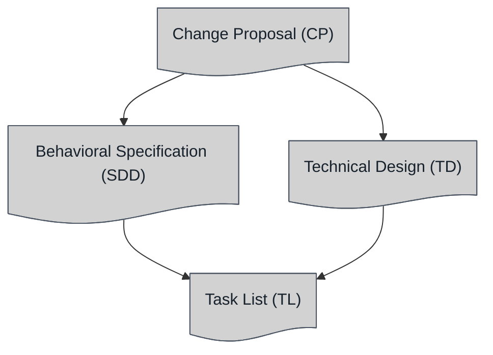

# SpecDev

Use this skill to turn project notes into documents people can build from, or to review a draft against its sources. Today you install it as **Technical Writer** (`technical-writer`). **SpecDev** is the planned name for the release that will also run OpenSpec commands. [Install the current skill](#get-the-source) · [See the release plan](plan/README.md)

## Document flow

### Core document flow

For a feature that changes product behavior and needs a design decision, OpenSpec uses four files. A proposal identifies the change. The specification and design can then be written in parallel. Both feed the task list.



### Expanded document flow

Solid arrows show the same core flow. A dotted arrow means **optional** and points from a document to the work it informs. A story can live in the specification. A task can live in the task list, in its own `task.md`, or in a tracker. An independent fix can start and finish with one task.


Tutorials, runbooks, repository guidance, diagrams and assistant instructions can be deliverables in their own right. Write them when someone needs them. Verification reports describe results after the corresponding checks have run.

## Supported document types

Each command below is approved for the SpecDev release. Today, ask Technical Writer for a document by name. A host may offer a short command directly. If it is already taken, use the qualified document command, such as `/specdev doc dr` in Claude Code or `$specdev doc dr` in Codex. OpenSpec supplies the format when the selected project already defines the document.

| Command | Document | What it answers and when you need it |
| --- | --- | --- |
| `/interview` | [Discovery Interview Record (DIR)](openspec/changes/ship-specdev/specs/spec-driven-authoring/spec.md#s14-1) | Planned format. What did the owner confirm, and what is still open? Use when answers affect scope. |
| `/brief` | [Product Brief (PB)](openspec/changes/ship-specdev/specs/spec-driven-authoring/spec.md#s05-1) | Planned format. Is this problem worth solving? Use before committing to a product direction. |
| `/prd` | [Product Requirements Document (PRD)](references/product_requirements_document.md) | Who needs what outcome? Use to agree on the product goal and scope. |
| `/capability-map` | [Capability Map (CM)](openspec/changes/ship-specdev/specs/spec-driven-authoring/spec.md#s15-1) | Planned format. Which capabilities can ship separately, and which depend on each other? |
| `/epic` | [Epic (EPIC)](openspec/changes/ship-specdev/specs/spec-driven-authoring/spec.md#s21-1) | Planned format. Which stories deliver one larger outcome? Use when they need coordination. |
| `/proposal` | [Change Proposal (CP)](openspec/changes/ship-specdev/proposal.md) | Why make this OpenSpec change, and what does it cover? |
| `/story`, `/us` | [User Story (US)](references/user_story.md) | What should one person be able to do, and what counts as success? |
| `/sdd`, `/spec` | [Behavioral Specification (SDD)](references/spec_driven_development.md) | What must the software do? Use for rules, exceptions, and observable outcomes. |
| `/requirement` | [Individual Requirement (REQ)](references/spec_driven_development.md#writing-an-individual-requirement) | Which single rule needs to be added or clarified? |
| `/research` | [Research Record (RR)](openspec/changes/ship-specdev/specs/spec-driven-authoring/spec.md#s16-1) | Planned format. What evidence settles a design question, and what remains unknown? |
| `/dr` | [Decision Record (DR)](references/decision_record.md) | Which option did we choose and why? Use when the rationale needs to survive. |
| `/hld` | [High-Level Design (HLD)](references/high_level_document.md) | Which parts of the system change, and how do they fit together? |
| `/lld` | [Low-Level Design (LLD)](references/low_level_design.md) | How will one component handle its data, interfaces, and failures? |
| `/ic` | [Interface Contract (IC)](references/interface_contract.md) | What do two components exchange, and how must each handle errors? |
| `/tm` | [Threat Model (TM)](references/threat_model.md) | What could go wrong, and which safeguards address each risk? |
| `/sod` | [Service Objectives Document (SOD)](references/service_objectives.md) | How reliable must the service be, and how will we measure it? |
| `/pol` | [Policy (POL)](references/policy.md) | What may or must people do, and who can approve exceptions? |
| `/std` | [Technical Standard (STD)](references/technical_standard.md) | Which technical rule applies, and how is compliance checked? |
| `/design` | [Technical Design (TD)](openspec/changes/ship-specdev/design.md) | How will we build this change? Record choices, trade-offs, and risks. |
| `/ip` | [Implementation Plan (IP)](references/implementation_plan.md) | How will we deliver and verify the work? Use the change design for one OpenSpec change or a separate plan for work coordinated across changes. |
| `/requirements-checklist` | [Requirements-Quality Checklist (RQC)](openspec/changes/ship-specdev/specs/spec-driven-authoring/spec.md#s19-1) | Planned format. Which requirements are ready to build, and which still need a decision? |
| `/feature-map` | [Feature Map (FM)](openspec/changes/ship-specdev/specs/spec-driven-authoring/spec.md#s17-1) | Planned format. Where can someone find a feature and check its behavior? |
| `/journeys` | [Critical Journeys (CJ)](openspec/changes/ship-specdev/specs/spec-driven-authoring/spec.md#s18-1) | Planned format. Which user paths matter most, and what outcome should each reach? |
| `/tp` | [Test Plan (TP)](references/test_plan.md) | What will testing cover, and when can it finish? |
| `/ts` | [Test Specification (TS)](references/test_specification.md) | What inputs, steps, and result will prove a requirement? |
| `/tasks` | [Task List (TL)](openspec/changes/ship-specdev/tasks.md) | What can start, what must wait, and how will each item be checked? Use for a multi-task change. |
| `/task` | [Task (TASK)](references/task.md) | What is this one assignment, and how will we know it is done? Use it for a bounded change or independently tracked work. |
| `/tsr` | [Test Status Report (TSR)](references/test_status_report.md) | While testing is underway, what passed, failed, or is blocked? |
| `/tcr` | [Test Completion Report (TCR)](references/test_completion_report.md) | When testing ends, what did it prove and what risks remain? |
| `/br` | [Bug Report (BR)](references/bug_report.md) | What failed, what should have happened, and how can someone investigate? |
| `/ir` | [Incident Report (IR)](references/incident_report.md) | Who was affected, how did the team recover, and what needs follow-up? |
| `/readme` | [Repository Readme (README)](references/readme.md) | What is this project, how do I start, and where can I find help? |
| `/tut` | [Tutorial (TUT)](references/tutorial.md) | How can a learner practice a skill and recognize a successful result? |
| `/htg` | [How-to Guide (HTG)](references/how_to_guide.md) | How do I complete this task or recover if a step fails? |
| `/exp` | [Explanation (EXP)](references/explanation.md) | How does this work, and why was it designed this way? |
| `/agent` | [Agent Instructions (AI)](references/agents_and_skills.md#agent-format) | When should this agent act, what may it do, and what must it return? |
| `/skill` | [Reusable Skill (SKILL)](references/agents_and_skills.md#skill-format) | How should an agent perform this repeatable task? |
| `/output-style` | [Claude Code Output Style (OS)](references/agents_and_skills.md#output-style-format) | How should Claude Code word and format its session replies? |
| `/diagram` | [Diagram (VIS)](references/visuals.md) | Which flow or relationship would a reader understand faster as a picture? |

A standalone Markdown task uses `task.md`. OpenSpec’s ordered checklist uses `tasks.md`. Its other default change files are `proposal.md`, `specs/<capability>/spec.md` and `design.md`. [Where the task list fits](#where-tasksmd-fits)

## What SpecDev adds to OpenSpec

In the planned release you’ll be able to ask for a document or run an OpenSpec command in the same conversation. A checkmark shows which tool does the work.

| Feature | OpenSpec | SpecDev |
| --- | :---: | :---: |
| Set up a project and find the change you want to work on | ✓ | |
| Provide the [four files for a change](#core-document-flow) and check their structure | ✓ | |
| Show progress, carry out approved tasks, update the project’s specs and archive a finished change | ✓ | |
| Let a project choose its own workflow and document templates | ✓ | |
| Write a [project document](#supported-document-types), such as a runbook or incident report | | ✓ |
| Check that the wording preserves the rules, exceptions and open questions in your sources | | ✓ |
| Offer a [document command](#supported-document-types) for each type of writing | | ✓ |

### How OpenSpec works behind SpecDev

Ask SpecDev to “write a support runbook” and it will use the writing guide for that document. Ask it to “plan refund approvals” in an OpenSpec project and it will use that project’s proposal, specs, design and task list as needed. When the project already defines the document, SpecDev will edit that file.

For commands, type `/specdev` in Claude Code or `$specdev` in Codex, followed by the OpenSpec command. For example, `/specdev init` will ask OpenSpec to set up the current project. SpecDev will check which commands the installed OpenSpec version provides, including commands added later. If a command is unavailable or needs setup, it will tell you. [OpenSpec commands](https://openspec.dev/docs/cli) · [Planned installation](#planned-release-installation)

## Requirements

- A host with file access and code execution: Codex, filesystem-enabled ChatGPT desktop, Claude Code, or a Claude environment supporting custom skills and Python.
- Python 3.11 or later on macOS, Linux, or WSL, with the packages in `scripts/requirements-lock.txt`.
- Source facts, a draft, or project files appropriate to the requested task. Missing evidence stays visible.

An external model CLI is optional. The native evaluation workflow uses the model already available in your host.

## Installation

### Planned release installation

The commands below are release targets. Use the source instructions below until this repository announces the release. Both skills will follow the same installation steps on macOS, Linux and WSL. SpecDev needs Python 3.11+ for writing and Node.js 22.20.0+ for the locked OpenSpec 2.1.1 integration.

1. Install the CLI once. The primary route downloads the installer from this repository’s GitHub release. It selects a compatible release asset and verifies it against that release’s `SHA256SUMS` before replacing the installed version. The alternative npm command will become available after publication under the verified package name.

   ```sh
   install_dir=$(mktemp -d)
   curl -fsSL https://github.com/fatonsopa/ai-technical-writer/releases/latest/download/install.sh -o "$install_dir/install.sh" && sh "$install_dir/install.sh"
   ```

   Or, for the planned npm package:

   ```sh
   npm install -g @fatonsopa/specdev@latest
   ```

2. Run `specdev --version`. Check the version and executable path before continuing if a second copy is already on your PATH. Then make the skill available in the hosts you use:

   ```sh
   specdev host init --tools codex,claude
   ```

   You can select just one host. Setup reports its destination, any missing prerequisite and the exact invocation to use in a fresh session. This connects SpecDev to the hosts. To start an OpenSpec project, separately invoke `/specdev init` in Claude Code or `$specdev init` in Codex from the intended project. That request delegates to OpenSpec.

3. To upgrade, use the original install channel again, then run `specdev host update` to refresh the entries you selected. For removal, first run `specdev host remove`. Then use `npm uninstall -g @fatonsopa/specdev` for npm, or the owned launcher and release paths printed by the GitHub installer. Keep user edits, other skills and project documents.

To have an agent help, ask it to follow this section for your chosen hosts, check for an existing installation first, and report the version, destination and working invocation. [Release acceptance](openspec/changes/ship-specdev/specs/spec-driven-authoring/spec.md#install-the-release-and-connect-a-host) · [OpenSpec’s installation method](https://github.com/Fission-AI/OpenSpec/blob/v2.1.1/docs/installation.md)

### Get the source

```sh
git clone https://github.com/fatonsopa/ai-technical-writer.git technical-writer
cd technical-writer
```

You can also download and extract the repository ZIP, then open its `technical-writer` folder.

### Codex and ChatGPT desktop

```sh
python3 scripts/install_skill.py --host codex
```

The installer prints its destination, normally `~/.agents/skills/technical-writer`. Invoke `$technical-writer` in Codex or select `@technical-writer` in ChatGPT desktop. If discovery does not refresh, start a new session or restart the app.

### Claude Code

```sh
python3 scripts/install_skill.py --host claude-code
```

The normal destination is `~/.claude/skills/technical-writer`. Invoke `/technical-writer` in Claude Code. An existing installation is preserved; use `--destination NEW_FOLDER` to test a separate installation.

### Set up the Python environment

Change to the installed folder printed by the installer, then run:

```sh
python3 -m venv .venv
.venv/bin/python -m pip install -r scripts/requirements-lock.txt
.venv/bin/python scripts/smoke_check.py
```

The self-check reports `passed: true`. It checks installed resources and exercises the document gate; it does not establish writing quality across all future inputs.

The repository is the complete skill. You can download its GitHub ZIP instead of cloning. For a Claude custom-skill upload, extract the repository, give the folder the name `technical-writer`, and compress that folder with your archive tool. Enable code execution in the host. See [Claude's upload instructions](https://support.claude.com/en/articles/12512180-use-skills-in-claude).

## Quick start

Examples use Codex's `$technical-writer` invocation. Use `/technical-writer` in Claude Code or `@technical-writer` in ChatGPT desktop.

> $technical-writer Write a Bug report from these facts: a category change was observed once; Save closed the dialog, but a fresh read still returned the old category. The expected behavior is that a confirmed save persists the chosen category. We have no inspected code or logs. Keep expected and actual results separate, preserve the unknown reproduction frequency, and do not invent a cause or file path.

Expected result: a scoped bug report with **How to reproduce**, **Expected result**, **Actual result**, **Relevant files**, and the other required report sections. It attributes the observations, preserves the evidence gaps, and proposes verification without claiming tests ran.

With code/file tools, the skill stages a draft, runs its applicable checks, reviews it against the source, and delivers the accepted file with a receipt. Without those tools or a completed review, it can provide a clearly identified draft; it must not claim validated acceptance.

### Where `tasks.md` fits

For a change using OpenSpec’s default schema:

1. State the reason and affected capabilities in `proposal.md`.
2. Define observable behavior in `specs/<capability>/spec.md`. Record the delivery approach and decisions in `design.md` as the schema requires.
3. Put ordered, independently verifiable steps in **one** `tasks.md`. Each row says what to change and how to check it. Link a task when it already owns an assignment or acceptance criterion.
4. On an authorized build, the agent reads OpenSpec’s apply context for the selected change, performs an eligible task, and updates that same checkbox after verifying the result.

You can inspect the [SpecDev task list](openspec/changes/ship-specdev/tasks.md) in this checkout. A standalone writing request can finish with the requested document.

## Usage scenarios

### Create a complete document

> $technical-writer Write a PRD from the attached product brief. Use the PRD reference and output contract. Separate agreed scope, proposed capabilities, and unresolved goals. Save the accepted document to the requested project path.

You receive a complete product document with the required sections and source-supported content. A heading check cannot replace the review of its purpose, facts, and scope.

### Work through an incomplete architecture brief

> $technical-writer Prepare an HLD for this feature. Inspect the existing code, schema and workflows first. Research missing technical information, then guide me through unresolved scope, behavior and design choices using the available question interface. Use diagrams only where they help explain the design.

The skill uses reliable project facts without asking you to repeat them. It asks focused questions in dependency order, explains meaningful options, and accepts written answers. Material unanswered choices remain open; an early document stays a draft. A complete brief needs no questionnaire. Diagrams carry their visible title, scope subtitle and symbol legend inside the image, with detailed element explanations below it. Sequence numbering expresses order; hierarchical IDs require actual decomposition.

### Explain a flow with controlled colors and background

> $technical-writer Explain this user flow using the shared flowchart style. Use the light dotted canvas and appropriate pastel shapes, export an SVG, retain its editable Mermaid source, and explain its elements below the diagram.

The [flowchart workflow](workflows/flowcharts.md) uses a shared palette and a background built into the SVG, so a Markdown theme cannot turn the canvas transparent or dark. Shapes and labels preserve meaning without color. Only needed diagrams are created. Their sources and exports are checked together before accepted delivery.

### Make a focused edit

> $technical-writer Change only this issue's title to describe the observed failure. Preserve the description and every other field.

You receive the requested title change. A file edit preserves content outside its declared title or excerpt; it does not expand into a complete document rewrite.

### Review a document

> $technical-writer Review this implementation plan against the supplied SDD. Return located gaps and recommended corrections. Do not rewrite the plan.

You receive findings tied to the source requirements. A review does not overwrite the document being reviewed or authorize implementation.

### Rewrite while preserving obligations

> $technical-writer Rewrite this technical standard for clarity. Preserve every obligation, exception, limit, and identifier. Explain any unresolved contradiction before changing its meaning.

The result retains the required governance structure and is checked against the original text. The preservation tools assist the comparison; semantic review is still required.

### Improve after a failed output

> $technical-writer This output omitted a required PRD section. Correct the draft and identify the reusable guidance or check responsible for the miss. Keep the failing input and output as a regression case; preserve unrelated guidance.

The failure remains recorded. A repaired draft needs new checks and review; a previous receipt does not transfer to changed content. Persistent skill maintenance follows the authorized scope.

## Check the result

The host normally runs this workflow for you. Use [the document-gate commands](workflows/rewrite.md#validate-the-actual-output) to inspect it or run it yourself. A request identifies the document type, operation, scope, source inputs, destination, explicit requirements, and material values to preserve.

1. `prepare` captures the source, destination baseline, selected guides, contract, and validator identity.
2. `check` validates structure, declared readiness, data constraints and selected visual requirements. Embedded Mermaid also needs a passing syntax check.
3. `packet` supplies the actual draft and frozen evidence for review.
4. `review` validates the submitted judgment, including every explicit requirement.
5. `finalize` delivers only the exact reviewed bytes when the applicable gates pass.

Missing sections, incorrect hierarchy, failed requirements, stale reviews, changed inputs, and newer destination edits block accepted delivery. Required structure does not authorize inventing content to fill a gap. Narrow edits and reviews use their own scope.

Complete Product Requirements Document (PRD), Spec Driven Development document (SDD), High Level Document (HLD), Low Level Design (LLD) and implementation-plan requests include a source-bound discovery record. See [discovery](workflows/discover.md) for its format. An empty decision list is valid when the sources settle the choices. A known unanswered blocking decision prevents ready delivery.

## Evaluate and improve the skill

The [host coverage procedure](evals/README.md#check-both-execution-hosts) freezes required Codex and Claude Code tasks and checks separately reviewed results for both. A missing host cannot pass through a combined success percentage.

Start with one representative case. From the installed skill folder:

```sh
.venv/bin/python evals/run.py prepare --session ../writer-eval-prd --kind prd --operation create --max-handoffs 2 --max-seconds 600 --host unknown
.venv/bin/python evals/run.py packet --session ../writer-eval-prd --case prd-create --phase generate
```

Use a new session path outside the skill for each attempt. The host performs the generation request, then submits its structured response with `submit --session SESSION --response RESPONSE.json`. A structurally valid output then receives a `grade` packet and a source-grounded judgment. See [evaluation instructions](evals/README.md) for the complete response format, custom input fixtures, expected properties, optional CLI adapters, and failure handling.

```sh
.venv/bin/python evals/run.py assess --session ../writer-eval-prd
```

| Result | Meaning |
| --- | --- |
| `task_success_percent` | Accepted attempts divided by evaluated attempts |
| `coverage_percent` | Evaluated attempts divided by planned attempts |
| `critical_failures` | Failed mandatory checks; these block acceptance |
| `pending_review` | Generated outputs still awaiting a valid judgment |
| `accepted` | Target, full coverage, critical checks, and reviews all pass |

Eight accepted results out of ten evaluated results is 80% task success. If twelve were planned, coverage is 83.3%. With no evaluated attempts, success is unmeasured. Malformed or structurally wrong task outputs count as failures. Missing execution or review leaves incomplete coverage. These are sampled task results, not universal accuracy.

Review failed outputs against their original inputs before changing the skill. Add a faithful regression, make a scoped correction, and rerun unchanged criteria on a new captured version. Use separate acceptance cases to assess generalization. Report the original failure as well as the retest.

Routine validation includes necessary bounded retries without another approval for each test. Record a concrete reason for an extension; the shared guard limits each batch and the number of extensions. Preserve failed attempts, targets and expected answers. Honor explicit user hard limits, and stop to report stalled progress or exhausted retry ceilings. Native handoffs count phase packets, not hidden provider requests or a billing cap.

## Limits and help

- **The skill is missing:** confirm the installed folder contains `SKILL.md` and use your host's explicit invocation. Refresh the session if needed.
- **A Python import fails:** run the environment setup with the installed `scripts/requirements-lock.txt` and use `.venv/bin/python`.
- **Checks reject a draft:** read the actual findings. Correct missing structure or data; do not add unsupported facts or weaken the contract.
- **An input, guide, or evaluator changed:** preserve the old evidence and prepare a new versioned session.
- **A result remains pending:** obtain the required review. A high aggregate score cannot waive critical failures or missing coverage.

For support, [open a GitHub issue](https://github.com/fatonsopa/ai-technical-writer/issues) with the skill version, host, sanitized input, expected result, actual result, and reproduction steps. Keep credentials and private project data out of public reports.

## Development

Preview the checks affected by the current changes, then execute that selection:

```sh
.venv/bin/python scripts/run_tests.py
.venv/bin/python scripts/run_tests.py --execute
```

The runner compares the last successfully tested checkpoint or Git HEAD and explains each selection. In a folder without Git or a checkpoint, supply exact `--changed PATH` arguments. New or unmapped paths require an impact rule; they do not trigger the full suite. Changed test files select changed methods, and overlapping selections run once.

Full testing follows the author's verification that every planned implementation change is delivered and no implementation work remains, with a completion record bound to the current artifact. User batch approval is not required. See [repository testing](workflows/improve_references.md#scope-repository-tests). A test authorization does not authorize a GitHub push.

Test actual output contracts and invalid-output controls as well as package integrity. Installation uses the same public repository files, including its tests. Private records, run snapshots and local environments stay outside the installed copy.

For Mermaid source diagnostics, install the parser dependencies outside the repository. Match the target version; the examples use 11.16.0:

```sh
npm install --prefix ../writer-diagram-tools --no-audit --no-fund mermaid@11.16.0 jsdom@26.1.0
export TECHNICAL_WRITER_MERMAID_MODULE_ROOT="$(cd ../writer-diagram-tools && pwd)"
.venv/bin/python scripts/visual_contracts.py WORK/source_draft.md --require-syntax
```

Use a Markdown source draft containing the Mermaid block for that diagnostic command. A parser pass establishes syntax only. Final diagrams require the rendered export with visible context; unrendered outputs remain drafts. Syntax, rendering and semantic review are separate results. The checker installs nothing.

Final diagrams use the shared SVG renderer. It preserves each notation and adds visible title/subtitle and a symbol legend. All supported diagram exports use the light dotted canvas. Install Mermaid CLI in the same external tool folder:

```sh
npm install --prefix ../writer-diagram-tools --no-audit --no-fund @mermaid-js/mermaid-cli@11.16.0
export TECHNICAL_WRITER_MERMAID_CLI="$TECHNICAL_WRITER_MERMAID_MODULE_ROOT/node_modules/.bin/mmdc"
.venv/bin/python scripts/render_diagram.py WORK/flow.mmd --out WORK/flow.svg
```

Use `--check` with the same arguments to check an existing export without rendering it again. If a browser configuration is needed, set `TECHNICAL_WRITER_PUPPETEER_CONFIG` to its JSON path. The [shared style](config/diagram_style.json) owns colors, contrast thresholds and dotted canvas. Every exported diagram includes its title/subtitle and legend. Its Mermaid code appears in a `text` code block below the explanation table, so readers can copy and edit it. See [diagram rendering](workflows/diagram_rendering.md). For accepted delivery, use `diagram_svg` (or `flowchart_svg`) in `context.visuals` and capture the SVG and same-named `.mmd` as sources before `prepare`; assets live beside the destination document. Changes invalidate their frozen review.


For diagram checks, run `.venv/bin/python scripts/check_diagram_collection.py`. The [diagram evaluation guide](evals/README.md#test-diagram-delivery) explains the real user-flow and sequence tasks, acceptance criteria, mechanical controls and evidence to retain.

## Find your way around

`SKILL.md` coordinates writing. `references/` owns document and language guidance; `examples/` demonstrates it. `contracts/` owns output structures. `scripts/` handles validation, accepted delivery and installation. `evals/` owns behavioral cases and assessment; its `adapters/` folder contains optional provider transport. `config/` records layout and component ownership. These components share contracts and preserve the distinction between mechanical checks and source-grounded judgment.

## License

[MIT](LICENSE).

Optional engineering formats include [Threat Model (TM)](references/threat_model.md), [Interface Contract (IC)](references/interface_contract.md) and [Service Objectives Document (SOD)](references/service_objectives.md). They define security assumptions, boundary semantics and reliability measurement when the project needs them; they are not compulsory project files.
