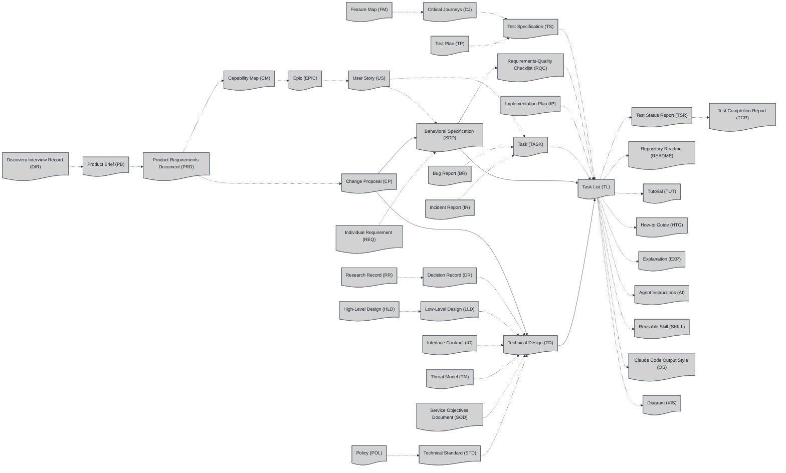

# SpecDev

SpecDev is a spec-driven development tool built on OpenSpec, which tracks software changes from proposal to implementation. Give it your refund policy and it can draft both the feature requirements and a guide for the people who approve refunds. [About OpenSpec](https://github.com/Fission-AI/OpenSpec)

<a id="planned-release-installation"></a>

## Installation

On macOS, Linux or WSL, you need Python 3.11 or later and Node.js 22.20.0 or later. In a terminal, install SpecDev from its GitHub release.

```sh
install_dir=$(mktemp -d)
curl -fsSL https://github.com/fatonsopa/ai-technical-writer/releases/latest/download/install.sh -o "$install_dir/install.sh" && sh "$install_dir/install.sh"
```

Check the installed version, then add SpecDev to the coding tools you use. Choose `codex`, `claude` or both.

```sh
specdev --version
specdev host init --tools codex,claude
```

[Update or remove SpecDev](docs/installation.md#update-or-remove-specdev)

## Quick start

Open your project in a new Codex or Claude Code session. In Codex, try the request below. In Claude Code, start the same request with `/specdev`.

> $specdev Read our refund policy and draft the requirements for refunding duplicate charges. Flag any decisions the policy leaves open.

## Check the result

If the policy says only managers may approve refunds, the draft keeps that rule. If the policy leaves repeat requests open, SpecDev asks, “What should happen if someone requests the same refund twice?”

For a new idea, start with a [product brief](docs/choosing-documents.md#product-brief). For agreed behavior, [plan the change](docs/choosing-documents.md#plan-an-openspec-change). For a small fix, ask for [one task](references/task.md).

<a id="what-specdev-adds-to-openspec"></a>

## How SpecDev and OpenSpec work together

OpenSpec manages each change’s files and tasks. SpecDev calls OpenSpec for you and adds writing tools for the rest of your project. To set up OpenSpec in a project, open it in Claude Code and enter `/specdev init`, or enter `$specdev init` in Codex. Other [OpenSpec commands](https://openspec.dev/docs/cli) work through the same entry.

| What you can do | OpenSpec | SpecDev |
| --- | :---: | :---: |
| Use [your team’s templates](https://openspec.dev/docs/customize-schemas) for a change. | ✓ | |
| See [what’s ready and what to do next](https://openspec.dev/docs/cli). | ✓ | |
| Keep a change’s [proposal, specs, design and tasks together](docs/choosing-documents.md#plan-an-openspec-change). | ✓ | |
| Track [open tasks](#where-tasksmd-fits) and archive the change when it’s done. | ✓ | |
| Get [questions about decisions](workflows/discover.md) your project files leave open. | | ✓ |
| Decide [what can ship first](docs/choosing-documents.md#capability-map) and keep the [research behind the decision](docs/choosing-documents.md#research-record). | | ✓ |
| Agree on [who needs a feature and what it should do](references/product_requirements_document.md). | | ✓ |
| Explain [why you chose a design](references/decision_record.md), [how its parts fit together](docs/writing.md#explain-a-flow-with-controlled-colors-and-background) and [what data they share](references/interface_contract.md). | | ✓ |
| Find [which screens](docs/choosing-documents.md#feature-map) and [user actions](docs/choosing-documents.md#critical-journeys) to test. | | ✓ |
| Give a developer [a user story](references/user_story.md) or [a single task with clear acceptance criteria](references/task.md). | | ✓ |
| Specify [what to try and what should happen](references/test_specification.md). | | ✓ |
| Report [what passed, what failed and what still needs testing](references/test_completion_report.md). | | ✓ |
| Ask for [a document by name or shortcut](#supported-document-types) and get a suggestion for what to write next. | | ✓ |
| Edit [the wording of an OpenSpec document](docs/writing.md#edit-an-openspec-document) without breaking its format. | | ✓ |
| Write [how-to guides](references/how_to_guide.md), [tutorials](references/tutorial.md) and [instructions for AI assistants](references/agents_and_skills.md). | | ✓ |
| [Edit one passage](docs/writing.md#make-a-focused-edit) or [rewrite a draft](docs/writing.md#rewrite-while-preserving-obligations) while preserving its meaning. | | ✓ |
| Check [whether the draft supports its claims](docs/writing.md#review-a-document) and [covers your requirements](docs/writing.md#check-the-result). | | ✓ |

## Document flow

### Core document flow

For a feature that changes product behavior and needs a design decision, OpenSpec uses four files. A proposal identifies the change. The specification and design can then be written in parallel. Both feed the task list.


### Expanded document flow

<details>
<summary>Show the optional documents and where they fit</summary>

Solid arrows show the same core flow. A dotted arrow means **optional** and points from a document to the work it informs. A story can live in the specification. A task can live in the task list, in its own `task.md`, or in a tracker. An independent fix can start and finish with one task.



Tutorials, runbooks, repository guidance, diagrams and assistant instructions can be deliverables in their own right. Write them when someone needs them. Verification reports describe results after the corresponding checks have run.

</details>

### Where `tasks.md` fits

Once the requirements and any needed design are ready, list the work and its checks in `tasks.md`. Link a separate `task.md` or tracker task when it already owns its own acceptance criteria. During implementation the agent picks a ready task, checks the result, and updates its checkbox. A standalone fix can start and finish in one task. [See how a requirement feeds a task and its check](docs/choosing-documents.md#plan-an-openspec-change).

## Supported document types

Ask for a document by name or use its short command. If another tool already uses a shortcut, give the command to SpecDev directly. For a decision record, use `/specdev doc dr` in Claude Code or `$specdev doc dr` in Codex.

<details>
<summary>Show all 39 documents and their commands</summary>

| Command | Document | What it answers and when you need it |
| --- | --- | --- |
| `/interview` | [Discovery Interview Record (DIR)](docs/choosing-documents.md#discovery-interview) | What did the owner confirm, and what is still open? Use when answers affect scope. |
| `/brief` | [Product Brief (PB)](docs/choosing-documents.md#product-brief) | Is this problem worth solving? Use before committing to a product direction. |
| `/prd` | [Product Requirements Document (PRD)](references/product_requirements_document.md) | Who needs what outcome? Use to agree on the product goal and scope. |
| `/capability-map` | [Capability Map (CM)](docs/choosing-documents.md#capability-map) | Which capabilities can ship separately, and which depend on each other? |
| `/epic` | [Epic (EPIC)](docs/choosing-documents.md#epic) | Which stories deliver one larger outcome? Use when they need coordination. |
| `/proposal` | [Change Proposal (CP)](docs/choosing-documents.md#plan-an-openspec-change) | Why make this OpenSpec change, and what does it cover? |
| `/story`, `/us` | [User Story (US)](references/user_story.md) | What should one person be able to do, and what counts as success? |
| `/sdd`, `/spec` | [Behavioral Specification (SDD)](references/spec_driven_development.md) | What must the software do? Use for rules, exceptions, and observable outcomes. |
| `/requirement` | [Individual Requirement (REQ)](references/spec_driven_development.md#writing-an-individual-requirement) | Which single rule needs to be added or clarified? |
| `/research` | [Research Record (RR)](docs/choosing-documents.md#research-record) | What evidence settles a design question, and what remains unknown? |
| `/dr` | [Decision Record (DR)](references/decision_record.md) | Which option did we choose and why? Use when the rationale needs to survive. |
| `/hld` | [High-Level Design (HLD)](references/high_level_document.md) | Which parts of the system change, and how do they fit together? |
| `/lld` | [Low-Level Design (LLD)](references/low_level_design.md) | How will one component handle its data, interfaces, and failures? |
| `/ic` | [Interface Contract (IC)](references/interface_contract.md) | What do two components exchange, and how must each handle errors? |
| `/tm` | [Threat Model (TM)](references/threat_model.md) | What could go wrong, and which safeguards address each risk? |
| `/sod` | [Service Objectives Document (SOD)](references/service_objectives.md) | How reliable must the service be, and how will we measure it? |
| `/pol` | [Policy (POL)](references/policy.md) | What may or must people do, and who can approve exceptions? |
| `/std` | [Technical Standard (STD)](references/technical_standard.md) | Which technical rule applies, and how is compliance checked? |
| `/design` | [Technical Design (TD)](docs/choosing-documents.md#plan-an-openspec-change) | How will we build this change? Record choices, trade-offs, and risks. |
| `/ip` | [Implementation Plan (IP)](references/implementation_plan.md) | How will we deliver and verify the work? Use the change design for one OpenSpec change or a separate plan for work coordinated across changes. |
| `/requirements-checklist` | [Requirements-Quality Checklist (RQC)](docs/choosing-documents.md#requirements-checklist) | Which requirements are ready to build, and which still need a decision? |
| `/feature-map` | [Feature Map (FM)](docs/choosing-documents.md#feature-map) | Where can someone find a feature and check its behavior? |
| `/journeys` | [Critical Journeys (CJ)](docs/choosing-documents.md#critical-journeys) | Which user paths matter most, and what outcome should each reach? |
| `/tp` | [Test Plan (TP)](references/test_plan.md) | What will testing cover, and when can it finish? |
| `/ts` | [Test Specification (TS)](references/test_specification.md) | What inputs, steps, and result will prove a requirement? |
| `/tasks` | [Task List (TL)](docs/choosing-documents.md#plan-an-openspec-change) | What can start, what must wait, and how will each item be checked? Use for a multi-task change. |
| `/task` | [Task (TASK)](references/task.md) | What is this one assignment, and how will we know it is done? Use it for a bounded change or independently tracked work. |
| `/tsr` | [Test Status Report (TSR)](references/test_status_report.md) | While testing is underway, what passed, failed, or is blocked? |
| `/tcr` | [Test Completion Report (TCR)](references/test_completion_report.md) | When testing ends, what did it prove and what risks remain? |
| `/br` | [Bug Report (BR)](references/bug_report.md) | What failed, what should have happened, and how can someone investigate? |
| `/ir` | [Incident Report (IR)](references/incident_report.md) | Who was affected, how did the team recover, and what needs follow-up? |
| `/readme` | [Repository Readme (README)](references/readme.md) | What is this project, how do I start, and where can I find help? |
| `/tut` | [Tutorial (TUT)](references/tutorial.md) | How can a learner practice a skill and recognize a successful result? |
| `/htg` | [How-to Guide (HTG)](references/how_to_guide.md) | How do I complete this task or recover if a step fails? |
| `/exp` | [Explanation (EXP)](references/explanation.md) | How does this work, and why was it designed this way? |
| `/agent` | [Agent Instructions (AI)](references/agents_and_skills.md#agent-format) | When should this agent act, what may it do, and what must it return? |
| `/skill` | [Reusable Skill (SKILL)](references/agents_and_skills.md#skill-format) | How should an agent perform this repeatable task? |
| `/output-style` | [Claude Code Output Style (OS)](references/agents_and_skills.md#output-style-format) | How should Claude Code word and format its session replies? |
| `/diagram` | [Diagram (VIS)](references/visuals.md) | Which flow or relationship would a reader understand faster as a picture? |

</details>

<a id="guides"></a>

## Documentation

- [Choose a document](docs/choosing-documents.md) for an idea, feature or standalone fix.
- [Write, edit or review a document](docs/writing.md) with examples you can use in your project.
- [Install, update or remove SpecDev](docs/installation.md).

## Support

[Find a fix for a setup or writing problem](docs/writing.md#limits-and-help) or [report an issue](https://github.com/fatonsopa/ai-technical-writer/issues).

## Development

[Contributor guide](docs/development.md) · [MIT license](LICENSE)
