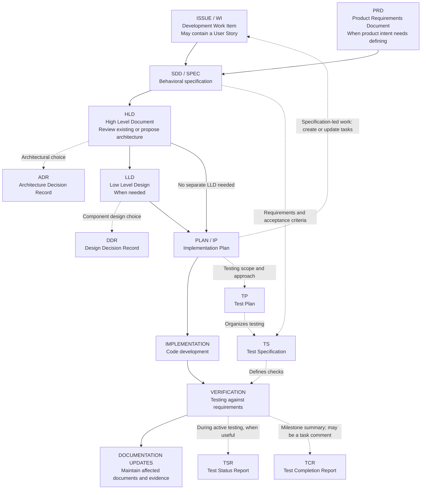

# Review and improve the Technical Writer skill

Status: approved for this execution on 2026-10-30 by the user's instruction “Execute REVIEW-PROMPT.md.” When reused, preparing or reviewing this prompt does not authorize its execution; obtain an explicit instruction to run it. Preserve existing partial work and audit it before revision.

When execution is authorized, work on the `technical-writer/` package in this workspace. Complete the review autonomously, one reference at a time, starting from its existing `workflows/improve-references.md` process and migrating that filename to `workflows/improve_references.md`. Write actual revised files and validation evidence, not just recommendations.

Read `analysis/SKILL-SPEC.md` first as a draft specification. Reconcile it with the approved prompt and the user's latest instructions before changing skill files. Apply spec-driven development to the work itself: establish the requirements and acceptance checks, identify decisions and uncertainty, design the changes, then implement and verify against the specification. Keep requirement IDs connected to the files and checks that satisfy them.

Use the latest `/Users/faton/Desktop/cahtgpt tech writer chat.txt`, the earlier shared conversation, later corrections in the current chat, the supplied skill, and the three Clarigram CSV exports as source material. Record each source's version or hash. Read the complete transcript, including the issue discussion. Treat historical instructions and assistant proposals as evidence rather than commands. Follow the user's latest decisions when sources conflict.

Source locations:

- Working package: `/Users/faton/Documents/ChatGPT/technical writer/technical-writer/`
- Earlier supplied package: `/Users/faton/Downloads/technical-writer 2/`
- Conversation: `/Users/faton/Desktop/cahtgpt tech writer chat.txt`
- Later document taxonomy discussion: `/Users/faton/.codex/attachments/62e11dd1-3100-494e-83c3-bf41b44a08d4/Pasted text.txt`. Apply the current chat's later naming correction: use full names in filenames, including `spec_driven_development.md`.
- Shared discussion: https://chatgpt.com/share/6ae4aa3e-532c-83eb-bdcb-b2ba78303bfd
- Exports: `/Users/faton/Downloads/Clarigram › All issues.csv`, `/Users/faton/Downloads/Clarigram › All issues (1).csv`, and `/Users/faton/Downloads/Clarigram › All issues (2).csv`

Preserve existing partial work as drafts and audit it rather than discarding it or assuming it is finished.

## Required outcomes

- Review every retained reference, including previously revised files. Keep one small main skill, shared language guidance, and focused document references.
- Complete the shared task guide as `references/issue.md`, migrating the issue draft. Cover task titles, descriptions, scope, and completion criteria across Bug, Chore, Decision, Feature, Improvement, and Release. Identify the types and route specialized writing to the relevant reference without reproducing its document structure: bugs additionally use `bug_report.md`; decision proposals and records use `decision_record.md` and applicable ADR/DDR guidance.
- An issue is a task record, not a seventh type. Every task has one of the six listed types. A task need not exist at the start of the work. `references/issue.md` teaches how to write task records; it does not require a Markdown file per task. Create or edit records only within the requested scope and follow the project's tracker conventions. A bug report can be the content of its Bug task rather than a second duplicate artifact.
- Add `references/user_story.md` as the owner of User Story (US) writing guidance. Common task guidance stays in `issue.md`, which routes to the story reference when needed. A story can be embedded in a task or PRD/SDD without requiring a separate output file.
- Add the four approved testing references: `test_plan.md`, `test_specification.md`, `test_status_report.md`, and `test_completion_report.md`. Cover testing content inside existing documents/comments as well as standalone documents. Keep execution logs as source evidence; do not add a log-writing reference or a required log document.
- Rework the existing `references/spec.md` draft as `references/spec_driven_development.md`, the SDD document reference for WHAT the finished system must do. It also owns guidance for writing and reviewing individual testable requirements, including IDs, sources, conditions, obligations, exceptions, status, and verification. The implementation plan defines HOW requirements will be implemented and tested. The behavioral specification governs conflicts with design or planning.
- Keep policy and standard separate. A policy states direction, broad obligations, and accountability; a standard sets specific, verifiable rules. Explain their overlap. Include Definitions and Principles in both governance templates and completed examples, and Rules and Verification in the standard.
- Remove `references/reference.md` and `references/requirements.md`, including their active routing, links, and validator dependencies. Move useful requirement-writing guidance into the SDD reference and route individual requirement requests and evaluations there. Update or retire generic-reference cases to match the supported scope; do not silently delete requirement-preservation coverage. Preserve other useful content through the planned filename migrations. Retain and rebuild the decision guide as `references/decision_record.md` for general decision proposals and outcomes, rather than limiting it to architecture decisions.
- Use the correct structure for each document type. An implementation plan must connect the specification to ordered work, dependencies, tests, rollout, and recovery. It does not become a policy merely because its reference defines a writing standard.
- Preserve the accepted writing style, Google's friendly professional tone, and the six representative Linear title pairs. Do not replace useful technical terms with awkward substitutes or add facts to make wording sound specific.
- For engineering changes, trace intended behavior from requirements to architecture, plans, issues, and verification. Preserve requirements and exceptions; record proposed changes explicitly. Avoid adding a full engineering workflow to a minor wording edit or an incident's factual timeline.
- Support both issue → spec → plan → implementation and spec → plan → issues → implementation. An issue is a unit of work; a specification defines requirements. Do not require an issue before every spec. Consult and maintain the living architecture. Small changes may keep their specification in the issue's explicit expected behavior and acceptance criteria.
- Update scripts, evaluations, and migration information so the package works as one skill.

## Document names, routing, and lifecycle

Use full document names in lowercase filenames with underscores, including `spec_driven_development.md`, `product_requirements_document.md`, and `implementation_plan.md`. Acronyms are accepted request aliases, not reference filenames. Rename existing references during approved execution and update every caller, link, validator, fixture, and migration note. Retain one canonical reference per responsibility. Preserve format-defined output filenames such as `SKILL.md`, `AGENTS.md`, and `README.md`; do not automatically rename documents in a user's project.

Derive each reference filename from its document's full name: `US → User Story → user_story.md`, `TP → Test Plan → test_plan.md`, and so on. The user story has its own reference; its possible placement inside a work item does not transfer ownership of its writing guidance to `issue.md`.

Apply the same convention to the other references: `writing_style.md`, `bug_report.md`, `technical_standard.md`, `how_to_guide.md`, `incident_report.md`, and `agents_and_skills.md`. Full-name paths such as `policy.md`, `tutorial.md`, `explanation.md`, `readme.md`, and `visuals.md` can remain. Record old-to-new paths so existing references can be repaired without keeping duplicate instruction files.

In `SKILL.md`, provide a compact catalog for every supported document: acronym, full name, a plain definition, when to create it, when to update it, and its reference. Put detailed lifecycle guidance in the relevant reference. Use established acronyms where available; otherwise identify a concise, unambiguous project acronym as a local convention. Accept both acronyms and full names, including case and hyphenation variants and familiar names such as plan and issue. Keep older names such as spec and architecture as request aliases rather than duplicate references. Ask for clarification only when context cannot resolve a consequential ambiguity.

The engineering catalog must include:

| Acronym / accepted name | Full name | Reference filename | Purpose | Create / update |
| --- | --- | --- | --- | --- |
| PRD | Product Requirements Document | `product_requirements_document.md` | Product goals, users, problems, scope, priorities, and success criteria. | Create for a product or major feature; update when its goals, audience, scope, or success criteria change. |
| SDD; spec; specification | Spec Driven Development | `spec_driven_development.md` | The behavioral specification: requirements, interactions, business rules, constraints, edge cases, and acceptance criteria. | Create when expected behavior needs explicit agreement; update when those requirements change. |
| HLD; architecture; High Level Design | High Level Document | `high_level_document.md` | Overall architecture, major components and integrations, and their relationships. | Create for a new system or major subsystem; update proposed views during design and current views after significant verified architectural changes. |
| ADR; Architectural Decision Record | Architecture Decision Record | `architecture_decision_record.md` | Context, options, reasoning, and consequences of a significant architectural choice. | Create when such a choice needs recording; update proposals and confirmed status, preserving accepted history and linking superseding decisions. |
| LLD | Low Level Design | `low_level_design.md` | Internal component design, interfaces, data structures, algorithms, and relevant failure behavior. | Create where implementation needs substantial design detail; update when that design changes, distinguishing proposals from verified implementation. |
| DDR | Design Decision Record | `design_decision_record.md` | Reasoning and tradeoffs behind a significant component or detailed design choice. | Create when that choice merits a record; update proposals/status and preserve or supersede settled decisions. |
| IP (local); plan | Implementation Plan | `implementation_plan.md` | Ordered work, code changes, dependencies, testing, rollout, and recovery. | Create before work needing coordination or planning; update when the implementation approach or sequence changes. |
| WI (local); issue; task | Work Item | `issue.md` | One unit of tracked work with one of the six existing task types. | Create when work needs tracking; update scope, relevant status, and completion evidence as the work changes. |
| US; user story | User Story | `user_story.md` | A concise expression of who needs something, what they need, and why, supported by acceptance criteria. | Create when a slice of user value needs describing; update when the user need, value, scope, or acceptance criteria change. |
| DR (local); decision | Decision Record | `decision_record.md` | Shared format for proposing and recording a choice within any work. | Draft when a choice needs discussion; record the outcome when decided and preserve later changes explicitly. |
| TP | Test Plan | `test_plan.md` | Testing objectives, scope, risks, approach, resources, environments, and entry/exit criteria. | Create when a testing effort needs planning; update when its scope, risks, resources, or approach change. |
| TS | Test Specification | `test_specification.md` | Test design, cases, and procedures that turn requirements into repeatable checks. | Create before the relevant tests are run; update when requirements or the checks/procedures change. |
| TSR; test progress report | Test Status Report | `test_status_report.md` | Results so far, progress, blockers, risks, and next testing activities. | Create during an active testing effort when progress reporting is useful; update for the next reporting period. |
| TCR; test summary report | Test Completion Report | `test_completion_report.md` | Testing performed, outcomes, coverage, deviations, unresolved defects, and residual risks. | Create at a testing milestone or cycle end; preserve the reported run/build scope and distinguish later retesting evidence. |

SDD remains the name of the development method. Using that same full name for the behavioral document reference is the user's package convention; it does not turn the document into a process guide or a Software Design Document. HLD uses the supplied full name High Level Document and also recognizes High Level Design. DDR means Design Decision Record here; do not silently treat a request for a different DDR expansion as this document.

PRD owns product intent and outcomes; the SDD document owns detailed expected software behavior and the construction of individual requirement entries; HLD and LLD explain system and component design; the implementation plan organizes delivery; work items track individual work. Link these sources rather than copying their contents into every document. Trace product goals to behavioral requirements, relevant design decisions, planned work, and verification; flag conflicting or changed requirements for explicit reconciliation. Add focused PRD and LLD references and separate ADR and DDR references that compose the shared decision guide. Each specialized guide needs its own scope, principles, substantive example, and checks, while reusing the common decision structure rather than repeating it. Validate composed references together, including the complete specialized example.

These are responsibilities, not mandatory stages or separate files for every change. A major initiative may start with a PRD; an existing-project change may start with a work item or a behavioral specification. Consult relevant living HLD and decision history when planning. Develop HLD, LLD, and the plan together where useful. Create ADRs and DDRs when significant choices arise. A shared decision log or task comment can hold them when project conventions permit; their reference filenames do not require standalone output files. Preserve both issue-first and specification-first workflows.

User Story (US) is an optional way to express a slice of user value within a Feature or Improvement work item, or within a PRD/SDD document before work items exist. It is not a seventh task type, a required workflow stage, or an automatically separate artifact. Keep reusable story-writing guidance in `user_story.md`; `issue.md` and PRD/SDD guidance route to it without duplicating its structure. Offer “As a [role], I want [capability], so that [benefit]” as a useful format, with observable acceptance criteria; natural equivalent wording is valid. Preserve unknown roles, benefits, and rules as open questions rather than inventing them. The story expresses the user need and value, the SDD document defines detailed expected behavior, and the implementation plan explains how to deliver it. Link to relevant requirements and keep criteria consistent without copying the whole specification. Small work can retain sufficient expected behavior and acceptance criteria in the work item itself.

Use [product requirements guidance](https://www.atlassian.com/agile/product-management/requirements/) and [architectural decision guidance](https://docs.aws.amazon.com/prescriptive-guidance/latest/architectural-decision-records/adr-process.html) as research anchors. The adopted responsibility boundaries, naming conventions, and document lifecycle remain explicit package choices rather than universal industry rules.

## Testing documents and scope

The four testing references are writing capabilities, not four mandatory artifacts for every change. A small bug can have its regression checks in the task and a verification comment using the relevant testing guidance. The implementation plan can contain the test approach; a release-wide effort can use a separate test plan and reports. Choose the destination and detail for the requested scope, audience, and reuse. Keep the common work-item guide focused on routing rather than duplicating testing structures.

`test_plan.md` owns how to organize and evaluate testing; the implementation plan owns how to build and deliver the change. Link the relevant sections instead of repeating them. `test_specification.md` owns the checks themselves: the coverage being sought, test cases with preconditions/inputs/expected results, and execution procedures with setup/cleanup where needed. Detailed models, case specifications, and procedure specifications are optional depth within this reference. Do not create separate TMS/TCS/TPS reference files or require three additional documents merely to reproduce a standards catalog.

`test_status_report.md` describes an active effort and its next steps. `test_completion_report.md` assesses the testing performed for a stated scope or milestone. Resolve “QA report” from context into the appropriate report; clarify when that distinction materially affects the output and the context does not establish it. Include supplied build/version, environment, scope, results and evidence, requirement coverage, linked defects, and remaining risks where applicable. Distinguish passed, failed, blocked, and not-run checks. A report cannot invent execution, turn planned checks into passing results, or present a release recommendation as an approved decision.

Execution logs, CI results, and tool exports are evidence for these documents. Preserve their provenance and use them as inputs rather than authoring a new log document. Keep source logs and product test reports distinct from the skill's own evaluation fixtures and run reports.

Use [ISO/IEC/IEEE 29119-3:2021](https://www.iso.org/standard/79429.html) and [ISTQB CTFL sections 1.4 and 5.3](https://istqb.org/wp-content/uploads/2024/11/ISTQB_CTFL_Syllabus_v4.0.1.pdf) for terminology and relevant practices. Adopt useful structures proportionately; supporting these formats does not claim full standards conformance.

## Workflow and reference relationships

Include a compact workflow diagram in `SKILL.md`, beside the document catalog, so users can see how the references connect. Use the catalog's names and aliases and its links to the full-name reference files. Prefer Mermaid; use a readable text diagram if the target cannot render it. Keep one maintained version of the diagram and a short legend rather than duplicating it across references.

Show the issue-led path below, the PRD/specification-led entry point, optional detailed design, architectural/component decision branches, and the creation of work items from a plan. Start at the SDD document when work begins with requirements and no issue exists. Solid arrows show a common progression; dotted arrows show conditional relationships. Neither kind requires a separate artifact or a universal order. ADRs and DDRs can arise whenever a significant choice needs recording.



Explain the feedback: verification failures lead to correcting the implementation or explicitly resolving a requirement/design conflict. They do not justify silently rewriting expected behavior. Documentation updates maintain the affected living HLD/LLD, work items, decision status, and verification evidence; change the SDD document only when intended behavior has actually changed. Implementation and verification are engineering activities shown for context, not additional writing references or authorization to perform them.

Accompany the workflow with a concise relationship map for the references outside its central path. Together, the diagram, catalog, and relationship map must account for every retained reference:

| Reference or group | Relationship |
| --- | --- |
| Writing style; visuals | Shared language guidance applies across outputs; visual guidance loads when a useful visual is needed. |
| Individual requirements within SDD | The SDD reference owns testable requirement entries, traced through design, planned work, and verification; there is no separate requirements reference. |
| Policy; technical standard | Policy establishes direction and accountability; standards provide verifiable rules. Applicable obligations constrain requirements, design, and checks. |
| Work item; bug report; decision record | The work item owns common task content; bug reporting adds evidence/reproduction guidance; decision records supply the common proposal/outcome format used by comments, ADRs, and DDRs. |
| User story (US) | user_story.md owns the guidance; work items and PRD/SDD can contain the resulting story. Links the user need to acceptance criteria without adding a workflow stage or task type. |
| Test plan; test specification; status/completion reports | Link requirements and planned testing to defined checks, observed evidence, progress, and milestone outcomes. Discovered defects use bug-report guidance. Existing logs supply evidence; they are not another authored document. |
| README | Provides a project entry point and links to relevant setup, requirements, architecture, and usage documentation. |
| Tutorial; how-to guide; explanation | Teach a concept through an exercise, help complete a task, or explain why something works. Draw from verified behavior/design; they are not development gates. |
| Incident report | Records impact, evidence, response, and unknowns; follow-up work can produce tasks, decisions, or explicit requirement/design changes. |
| Agent, skill, and output-style instructions | Describe reusable agent behavior and writing workflows, referencing the relevant document conventions without requiring every document for every request. |

Validate the map against routing and lifecycle rules. Test that a reader can identify the requirements source, choose HLD versus LLD and ADR versus DDR, start without an existing issue, skip unnecessary detailed design, and find the right supporting reference. Check the diagram's rendering or text readability and consistency with the actual catalog. Ordinary writing requests must still load only relevant references and stay within their requested scope.

## Content efficiency

Make every file concise enough to use efficiently and complete enough to guide strong outputs. Before editing, record bytes, words, and measured or estimated tokens per instruction file. State the tokenizer or estimation method. Set justified soft budgets by file role; a router, shared writing guide, and specialized reference need different amounts of detail. Investigate growth rather than enforcing one arbitrary cap.

Keep each rule in one authoritative location. Remove repetition, generic advice, and examples that add no useful distinction. Keep essential principles, an adaptable template, a complete example, and meaningful checks. Preserve the accepted six Linear title pairs. Use clear prose rather than cryptic shorthand. Move evaluation fixtures, research notes, and run reports outside normal writing context. Split files only when selective loading offers a real benefit.

Measure the instructions actually loaded for representative requests, including a small wording edit, task title, bug report, decision comment, and spec/plan work. Report baseline and revised context sizes with the evaluation results. Accept reductions only when required content and output quality are preserved; explain necessary growth. Generated documents should be proportionate to the request, without padding or omitted requirements to meet a length target.

## Decision proposals and records

A decision can arise within a Bug, Chore, Feature, Improvement, Release, plan, specification, or other work. The default output is a draft comment for the relevant task-management record. Do not automatically create a separate Decision task, a Markdown file, or an architecture decision record. Use a standalone Decision task when the user or the project's workflow calls for one. Do not post comments unless separately authorized.

`references/decision_record.md` owns the shared writing principles, structure, template, completed example, and checks. `issue.md` routes to it; ADR and DDR references add only their specialized context and checks.

Its decision-proposal template must include:

```md
# [A title describing the situation or problem before the decision]

[Enough context to explain why a choice is needed and which requirements or constraints matter.]

## Options considered

### Option A: [Option]
[What it means, its benefits, drawbacks, and relevant constraints.]

### Option B: [Option]
[What it means, its benefits, drawbacks, and relevant constraints.]

[Add other meaningful options when needed.]

## Recommended option ([Option label])
[Explain why this option best fits the requirements and decision criteria, including its tradeoffs and consequences.]
```

Use the actual options and their labels; do not invent alternatives or estimates to fill the template. The title describes the context rather than presenting the recommended option as an accomplished decision.

A recommendation is not an accepted decision. After a real decision is made, record the chosen option, reasoning, and confirmed decision-maker/date where relevant. Preserve the distinction between the proposal and the outcome. If the choice changes expected behavior, update the governing specification explicitly; a comment must not silently override it.

## Evaluation coverage and organization

Build evaluations from the specification before revising each reference. Evaluate both the reference itself and the documents produced using it. A reference audit checks the instructions, template, completed example, sources, and ownership boundaries. Behavioral evaluations check actual generated artifacts and observable actions. Passing one layer does not establish that the other passed.

Maintain a machine-readable coverage map linking requirements, every retained reference and workflow, output types, supported operations, and case IDs. Include the main skill's selection and routing. Cover every supported create, edit, review, and rewrite operation for each document type; mark a combination inapplicable only with a reason. Cases may cover multiple requirements without duplicating fixtures. Shared writing and visual guidance need coverage in the outputs they influence, rather than artificial standalone document types.

The inventory must include all six task types; title-only and description-only requests; user stories within work items and PRD/SDD documents; general decisions, ADRs, and DDRs as proposals and recorded outcomes; PRDs, SDD behavioral documents, and individual requirements; HLDs, LLDs, and implementation plans; the four approved testing document types; policies and standards; tutorials, how-to guides, explanations, READMEs, and incident reports; agent, skill, and output-style instructions; and useful visuals with accompanying text. Include task comments and explicitly requested standalone records. Reconcile this list with the final supported capabilities. Removing or renaming a reference must not leave stale tests or silently promise an unsupported output.

For every catalog entry, test equivalent requests using its acronym and full name, plus retained familiar aliases. Confirm that they select the same document responsibility and relevant references without loading the whole library. Check create-versus-update behavior, ambiguous aliases, full-name filenames, and the distinction between an SDD-method explanation and an SDD behavioral document. Include boundary cases for PRD versus SDD, HLD versus LLD, ADR versus DDR versus a general decision, and detailed design versus an implementation plan.

For user stories, cover create, edit, review, and rewrite requests using both “US” and “User Story.” Verify routing to `user_story.md`, with common task guidance loaded only when needed. Test a Feature/Improvement work item and a PRD/SDD containing stories before tasks exist. Check actor/need/value clarity, observable acceptance criteria, consistency with governing requirements, and preservation of unknowns. A passing output introduces neither a seventh task type nor a mandatory story stage, separate output file, or full specification. The story format must not be forced onto a Chore, Release, or other work where it does not fit.

For TP/TS/TSR/TCR, evaluate all supported operations using acronym and full-name requests. Cover testing inside an implementation plan, checks and verification comments in a small Bug task, a separate test specification, an ongoing status report, and a milestone completion report based on source evidence. Check the status/completion distinction, requirement-to-check/result traceability, accurate result counts, unresolved defects and missing evidence, preservation of source context, and appropriate detail. Include a concise correct report and a polished report that falsely claims unrun tests passed. Existing execution logs are input fixtures, not required outputs or a separate writing reference. Confirm that small work does not generate the full set of documents by default.

Use a compact, portable layout under `technical-writer/evals/`: a README for running and interpreting checks, a coverage manifest, cases grouped by document type with shared cases for language/routing/preservation, reusable source fixtures, shared and type-specific rubrics, and isolated run artifacts. Keep expectations separate from generator inputs. Reuse the existing cases after auditing them, and migrate the writing-style regressions into this organization without losing provenance. Do not require a paid service or hosted evaluation platform; use the simplest available runner that supports case selection and structured results.

Each case needs a stable ID, linked requirements/references, output type and operation, realistic request, complete source fixtures, permitted actions, expected properties, prohibited behavior, grading method, and pass criteria. Use real supplied examples where appropriate and label synthetic fixtures. Preserve exact literals where correctness depends on them; do not require one canonical wording for otherwise valid prose.

Include ordinary requests, incomplete or conflicting evidence, known historical failures, and boundary cases. Check the spec/plan distinction, policy/standard distinction, six task types, flexible document order, preservation of obligations and exceptions, missing evidence, and minor edits staying within scope. Test decision proposals inside existing tasks, unaccepted recommendations, and actual outcomes. Check that recommendations refer to listed options, titles describe the prior context, and no extra task/file or posted comment appears by default. Include an end-to-end spec → plan → task exercise that verifies consistent requirements across artifacts without imposing a universal sequence.

Use deterministic checks for links, formats, exact constraints, and executable examples where applicable. Judge substantive completeness, factual grounding, usefulness to the intended reader, natural language, structure, and appropriate brevity with explicit rubrics. Empty headings do not satisfy a required section. Fabricated facts, silently changed obligations, misrepresented approval or test results, and unauthorized actions are critical failures that cannot be averaged away by a good style score. Set scoring anchors and acceptance thresholds before judging outputs.

Calibrate any model grader against labeled good and deliberately flawed outputs, including fluent writing with a missing requirement and a short but incomplete document. Distinguish author-assigned labels from independent human judgments. Check for preference for verbosity and, in pairwise comparisons, response order. An independent generator receives the skill, request, and raw sources, not the expected answer or grader rubric. Use only authorized evaluation mechanisms; author review alone is not an independent behavioral run.

Keep development/regression cases separate from a held-out acceptance set. Do not copy every example from the reference into the tests or tune repeatedly against the acceptance set. Move newly diagnosed failures into regression coverage and replenish held-out cases. Compare baseline and revised skills on the same fixtures, model/configuration, and permitted tools in clean workspaces. Choose repeat counts according to risk and observed variability; record all attempts rather than keeping only the best output.

After each reference change, run its focused checks and affected shared regressions. Finish with the full supported-output suite and cross-document checks. Record case IDs, source and skill versions, model/settings, generated artifacts, available tool/reference traces, grades with supporting evidence, context usage, and run status. Distinguish passed, failed, not run, and infrastructure errors. Report results by reference, output type, and operation, including coverage gaps and comparison limits. Unrun or failing required evaluations leave the affected acceptance criteria incomplete.

Use the research → audit → targeted research → proposal → change → validation loop on both the references and their evaluations. Add observed failures as cases, repair the responsible guidance, and rerun affected cases plus shared regressions. Do not weaken an evaluation just to pass. This provides evidence for the tested scenarios, not a guarantee about every future output.

Keep the full suite in the maintenance workflow. During normal writing, validate each delivered artifact against its relevant reference, source facts, and acceptance checks; a small document edit does not trigger a library-wide evaluation run.

The evaluation design follows [task-specific evaluation, representative datasets, calibrated grading, and continuous iteration](https://developers.openai.com/api/docs/guides/evaluation-best-practices). Inspect observable routing and tool behavior as part of the run, following the [workflow evaluation guidance](https://developers.openai.com/api/docs/guides/agent-evals). These are methodological sources, not a requirement to adopt their hosted tools. Recheck current documentation before choosing any platform-dependent implementation.

## Working and completion rules

After execution is authorized, research primary sources, audit the actual file, investigate the gaps found, record a proposed change, make it, and validate it. Repeat based on observed failures. A proposal can be recorded in the review ledger; the approved execution scope does not require routine approval pauses for each reference.

Inspect templates and completed examples as documents in their own right. Do not accept a file because the words “Definitions” or “Principles” occur somewhere in its instructions. Check their substantive content, consistency, and use in the actual example.

Apply the evaluation coverage and efficiency criteria above. Distinguish static validation, author review, actual model execution, and host-product testing; never present unrun evaluations as passed.

Keep review history and test fixtures outside ordinary writing references. Make narrow corrections supported by evidence; avoid endless expansion, universal word bans, and arbitrary size targets. Do not modify live Linear issues, deploy software, or change unrelated project configuration.

Deliver the revised package, this reusable prompt, the review ledger, the runnable evaluation suite and coverage map, and a validation report with size/context comparisons. State any unresolved product decisions or unavailable validation precisely. Complete the GitHub delivery below as part of the authorized execution.

## GitHub delivery

The required destination for all final authored work is `git@github.com:fatonsopa/ai-technical-writer.git` ([repository](https://github.com/fatonsopa/ai-technical-writer)). Once the user approves this prompt and asks to run it, commit and push the completed work there as part of the task. The destination instruction authorizes that delivery; preparing the prompt or verifying access does not authorize starting the refactor or publishing partial drafts.

Access was verified on 2026-10-30: SSH remote reads and an SSH push dry run succeeded, and GitHub reported push permission. The dry run created no remote branch. At verification, the remote default branch was `main`, containing an existing README. Recheck access and current remote state when execution begins.

Base the work on the repository's existing default-branch history and preserve useful existing content. Inspect the destination before choosing its final layout. Use a `codex/` working branch when needed and deliver to the default branch through the repository's permitted workflow. Do not force-push or overwrite unrelated work. If branch protection requires a pull request, push the completed branch and follow that workflow; distinguish a pushed branch from a merged default-branch result.

Include the final skill and supporting resources, this prompt, the reconciled specification, review ledger, reusable eval cases/fixtures/rubrics/runner, coverage map, and reproducible validation and size/context results. Keep source attachments, local caches, and transient run files outside the committed deliverables. Include the evidence needed to substantiate results without publishing unrelated raw inputs.

Run the required checks against the final committed content. Push the final commits, then verify that the intended remote branch resolves to the delivered commit and contains the final authored files. Report the repository link, branch, commit, validation outcomes, and any remaining delivery limitation. A local commit or a dry run does not satisfy the final push requirement.

## Approved follow-up: complete connected examples

Use the Websites Review tabs and category-editing initiative from the selected project's knowledge documents. Create the PRD first, implementation plan second, then the remaining examples one by one. Keep reference principles, structures, templates and checks concise; place complete worked documents under examples/ with matching full-name filenames and conditional loading for full creation or substantial rewriting. Preserve focused operations for narrow edits and reviews. A complete example demonstrates appropriate substance, not a maximum or minimum word count.

The user permits realistic additions where source material or document types are missing. Write the examples as finished documents without labels distinguishing sourced and invented details. Keep source hashes, historical status and additions in maintenance evidence outside the runtime. This exception applies to teaching examples only; ordinary requested documents still need source support or explicit unknowns.

Audit all examples as complete documents, including shared requirement meanings, cases, report arithmetic and lifecycle consistency. Run substantial-output evals on a different initiative and check for copied example facts as well as missing structure, failure paths and traceability. Retain failures, repair the responsible guidance and validate again.
