# Document relationships

This view shows how the documents in the Technical Writer catalog usually hand work to one another. The [skill entry](../SKILL.md#document-relationships) explains who owns what; use this page when you want the whole picture.



These are common handoffs, not a mandatory sequence. Work can start with a Task, Product Requirements Document (PRD), or Spec Driven Development document (SDD); decisions and testing support the relevant work.

| Component | Explanation |
| --- | --- |
| 1. Task | A tracked task may start the work or be created later from the plan. Small tasks can include their own expected behavior and acceptance criteria. |
| 2. Product Requirements Document (PRD) | Define the product need, users, outcomes and scope when those decisions need agreement. |
| 3. Spec Driven Development document (SDD) | Define expected behavior and testable requirements. This is the source of truth for what the finished system must do. |
| 4. High Level Document (HLD) | Review the living architecture and describe significant system boundaries, responsibilities and interactions. Update it when verified implementation changes the architecture. |
| 5. Decision Record (DR) | Record the context, options, recommended choice and eventual outcome for a material decision. A record can support architecture, detailed design or delivery planning. |
| 6. Low Level Design (LLD) | Describe internal contracts and design where the work needs that detail. A separate document is optional for straightforward changes. |
| 7. Implementation Plan (IP) | Explain how to implement and verify the requirements within the architecture, including dependencies and work breakdown. |
| 8. Implementation | Build the approved behavior using the plan and applicable design decisions. |
| 9. Verification | Check the implementation against the agreed requirements. A failure leads to repair or explicit conflict resolution, not an automatic requirements rewrite. |
| 10. Update affected documentation | Update affected architecture, user guidance and other maintained documentation using verified results. |
| 11. Test Plan (TP) | Define testing scope, risks, approach and exit criteria when testing needs coordination. |
| 12. Test Specification (TS) | Define checks, inputs, procedures and expected results linked to the requirements. |
| 13. Test Status Report (TSR) | Report testing progress, observed results, blockers and the next work while testing continues. |
| 14. Test Completion Report (TCR) | Report the milestone’s tested scope, coverage, results and remaining risks after testing ends. |

**Mermaid source**

```text
%% Diagram: Flowchart
%% View: reference
%% Subtitle: Requirements, design, delivery and testing documents and their relationships.
flowchart TD
    accTitle: Development documentation workflow
    accDescr: Work may start with a task or specification. Design and planning lead to implementation, verification, and documentation updates. Decision Record (DR) entries and test documents support those activities as needed.
    WI@{ shape: doc, label: "1. Task" } --> SDD@{ shape: doc, label: "3. Spec Driven Development document (SDD)" }
    PRD@{ shape: doc, label: "2. Product Requirements Document (PRD)" } --> SDD
    SDD --> HLD@{ shape: doc, label: "4. High Level Document (HLD)" }
    HLD -. "Architectural choice" .-> DR@{ shape: doc, label: "5. Decision Record (DR)" }
    HLD --> LLD@{ shape: doc, label: "6. Low Level Design (LLD)" }
    HLD -->|"No separate Low Level Design (LLD) needed"| IP@{ shape: doc, label: "7. Implementation Plan (IP)" }
    LLD -. "Component choice" .-> DR
    LLD --> IP
    IP -. "Create tasks when needed" .-> WI
    IP --> CODE["8. Implementation"]
    CODE --> VERIFY["9. Verification"]
    VERIFY --> UPDATE["10. Update affected documentation"]
    IP -. "Testing approach" .-> TP@{ shape: doc, label: "11. Test Plan (TP)" }
    SDD -. "Acceptance behavior" .-> TS@{ shape: doc, label: "12. Test Specification (TS)" }
    TP -.-> TS
    TS -. "Defined checks" .-> VERIFY
    VERIFY -. "During testing" .-> TSR@{ shape: doc, label: "13. Test Status Report (TSR)" }
    VERIFY -. "Milestone outcome" .-> TCR@{ shape: doc, label: "14. Test Completion Report (TCR)" }

class WI,PRD,SDD,HLD,LLD,DR,IP,TP,TS,TSR,TCR document
class CODE,VERIFY,UPDATE process
```
