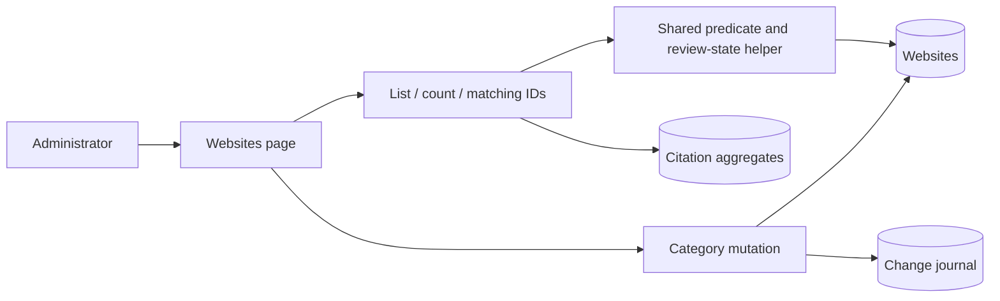

# Websites administration architecture

Status: Target architecture for Websites Review, with the existing foundation identified below
Behavior source: [SDD](spec_driven_development.md), WEB-01–WEB-12

## Scope, terms, and drivers

This view covers the administrator's website lists and manual category changes. It excludes the internals of categorization providers and confirmation jobs. Those systems supply verification state; this feature reads that state without restarting their work.

Pending and Review describe outstanding work. All remains the existing cited administration population. Active means not deleted. The important drivers are complete queue visibility, one classification rule, attributable manual changes, compatibility with current callers, and honest partial-failure feedback.

## Existing foundation

The React administration interface calls PostgreSQL functions through the existing Supabase integration. Website records hold category and verification state. Citation aggregates provide citation information and determine membership in the current All list. Administrator authorization uses the signed-in user and the existing administrator-role check.

The Websites page and bulk category dialog already exist. The old All query relies on citation aggregates, so it cannot serve as the complete unsettled-work population. The current interface also lacks a dedicated Review surface with consistent inline category assignment.

## Target components and responsibilities

| Component | Responsibility |
| --- | --- |
| Websites page and sub-tabs | Tab/filter state, keyset navigation, counts, and selected IDs |
| Shared category cell and edit hook | One active edit, explicit save/cancel, saving and failure state |
| Bulk category dialog | Category or clear selection, sequential batching, progress and reconciliation |
| Administration read functions | Authorized list, count, and matching-ID results using a shared predicate |
| Central review-state helper | Map verification state to Pending, Review, or neither |
| Category mutation | Authorize and atomically update one request, verification metadata, and journaled changes |
| Website store and change journal | Current category/verification state and attributable change history |

### Main flow

The classifier decides queue state; the shared predicate adds active-row visibility and requested filters. Citation joins remain optional for Pending and Review. All keeps its current aggregate requirement. This distinction prevents uncited websites from disappearing while preserving existing All behavior.

## Runtime and data flow

Opening a tab requests its first page and the corresponding counts. The server applies administrator authorization and shared filters. Matching-ID selection uses the same population as the visible page and count. Tab or filter changes discard the previous keyset cursor.

For an inline assignment, the browser submits one ID to the same mutation used by the bulk dialog. The database validates the caller and category, updates category and verification state in one transaction, and writes change history through the existing journal mechanism. Only a committed response permits the interface to confirm success.

Bulk selection is a client-coordinated sequence of transactions, each with at most 500 IDs. There is no transaction covering the entire selection. A later failure cannot undo earlier committed batches. The client stops, retains progress, and reconciles an uncertain result before a user chooses a retry.

After confirmed writes, the page invalidates affected rows and counts. A website may leave the current queue; retaining it until the next manual reload would contradict the successful result.

## Trust and data ownership

PostgreSQL owns classification and current category state. The browser may display returned state but does not maintain its own parked rule. The authenticated administrator is the actor; client-supplied text cannot substitute for the authenticated identity.

Read authorization and write authorization apply at the database boundary. Hiding a button is useful interface behavior, but it does not authorize a request. The change journal records committed modifications. No new event service, queue, or independent category store is introduced.

## Deployment and operations

Deploy additive database support before the new browser callers. Keep old read signatures compatible for one release, then remove the superseded Review filter paths separately. Concurrent index builds have their own migration boundaries.

Measure database first-page queries and maximum-size mutation requests against WEB-12. Observe failed mutations, missing actor attribution, and list/count mismatches during rollout. If the interface must be withdrawn, preserve the additive database support and committed category history. Correct erroneous decisions with attributable compensating changes rather than deleting history.

## Decisions and risks

The [ADR](architecture_decision_record.md) records why classification remains in the database. The [DDR](design_decision_record.md) records why bulk work stops after a failed batch and requires reconciliation.

The main integration risks are a missing parked-state prerequisite, changed grants on replaced functions, optional aggregate joins becoming mandatory, and client feedback that mistakes a lost response for a rollback. The [LLD](low_level_design.md) defines the contracts and failure branches; the [plan](implementation_plan.md) owns sequencing.

After implementation, update this document with the verified deployed structure and remove obsolete transition details. Do not label the target view as current merely because the plan was completed.
