# Websites administration architecture

Status: Target architecture for Websites Review, with the existing foundation identified below
Behavior source: [Spec Driven Development document (SDD)](spec_driven_development.md), WEB-01–WEB-12

## Scope, terms, and drivers

This view covers the administrator's website lists and manual category changes. It excludes the internals of categorization providers and confirmation jobs. Those systems supply verification state; this feature reads that state without restarting their work.

Pending and Review describe outstanding work. All remains the existing cited administration population. Active means not deleted. The important drivers are complete queue visibility, one classification rule, attributable manual changes, compatibility with current callers, and honest partial-failure feedback.

## Existing foundation

The React administration interface calls PostgreSQL functions through the existing Supabase integration. Website records hold category and verification state. Citation aggregates provide citation information and determine membership in the current All list. Administrator authorization uses the signed-in user and the existing administrator-role check.

The Websites page and bulk category dialog already exist. The old All query relies on citation aggregates, so it cannot serve as the complete unsettled-work population. The current interface also lacks a dedicated Review surface with consistent inline category assignment.

## Target components and responsibilities

| Component | Responsibility |
| --- | --- |
| Websites page and sub-tabs | Tab/filter state, keyset navigation, counts, and selected IDs |
| Shared category cell and edit hook | One active edit, explicit save/cancel, saving and failure state |
| Bulk category dialog | Category or clear selection, sequential batching, progress and reconciliation |
| Administration read functions | Authorized list, count, and matching-ID results using a shared predicate |
| Central review-state helper | Map verification state to Pending, Review, or neither |
| Category mutation | Authorize and atomically update one request, verification metadata, and journaled changes |
| Website store and change journal | Current category/verification state and attributable change history |

### Website administration read and write relationships



This view shows responsibilities and data relationships, not the order of a request. The numeric references identify components so the table can explain the same elements.

| Component | Explanation |
| --- | --- |
| 1. Administrator | A signed-in administrator browses review tabs and requests category changes. Database authorization still checks each mutation; a visible control alone is not permission. |
| 2. Websites page | The page coordinates tabs, filters, counts and category editing. It requests data from the read functions and sends category changes to the mutation function. |
| 3. Administration reads | The list, count and matching-ID functions answer different page needs using the same filters. Matching IDs identify all websites selected by those filters, including rows outside the current page. |
| 4. Shared visibility and review rules | The shared classifier decides which review tab each website belongs to. The read functions reuse these rules so that the list, count and bulk-selection IDs agree. |
| 5. Websites | Website records hold category and verification state. Reads classify those records, while a permitted mutation updates the selected records. |
| 6. Citation aggregates | Read functions consult citation information when the selected tab or filter needs it. This store supplies evidence for classification rather than accepting category writes. |
| 7. Category mutation | The database API checks administrator access and input, then changes categories and writes history in one transaction. Each request handles at most 500 IDs. |
| 8. Change journal | The journal records who changed a category and what changed. If journaling fails, the request’s website changes roll back as well. |

**Mermaid source**

```text
%% Diagram: Architecture diagram
%% View: detail
%% Subtitle: Read filters, category changes and their audit history.
flowchart LR
    accTitle: Website data access
    accDescr: The administrator uses the Websites page. Shared read rules keep rows, counts and matching IDs consistent. An authorized mutation commits category changes with their history.
    A("1. Administrator") -->|Browse and edit| UI["2. Websites page"]
    UI -->|Request filtered rows, counts or IDs| R["3. Administration reads"]
    R -->|Apply shared rules| C["4. Shared visibility and review rules"]
    C -->|Evaluate website state| W[("5. Websites")]
    R -->|Read when required| G[("6. Citation aggregates")]
    UI -->|Assign or clear a category| M["7. Category mutation"]
    M -->|Update category and verification| W
    M -->|Record committed changes| J[("8. Change journal")]

class A actor
class UI,R,C,M process
class W,G,J datastore
%% Legend: flow_arrow | Relationship
```

The classifier decides queue state; the shared predicate adds active-row visibility and requested filters. Citation joins remain optional for Pending and Review. All keeps its current aggregate requirement. This distinction prevents uncited websites from disappearing while preserving existing All behavior.

## Runtime and data flow

### Load a review tab

Opening a tab requests its first page and the corresponding counts. The server applies administrator authorization and shared filters. Matching-ID selection uses the same population as the visible page and count. Tab or filter changes discard the previous keyset cursor.

### Website review workflow

For inline and bulk assignments, the browser submits website IDs and the chosen category to the same mutation. The API validates the request and commits category changes and history together. This overview shows the confirmed-success path; the [Low Level Design (LLD)](low_level_design.md) separates rejection, rollback and response loss for implementation review.



This view covers a successful category save. Failed or uncertain saves need different handling; keep that explanation in the document or a separately scoped view. Do not infer who reconciles saved state when the source leaves that responsibility unknown.

| Component | Explanation |
| --- | --- |
| 1. Submit category change | The administrator submits the selected website IDs and the chosen category. This does not prescribe particular controls or clicks. |
| 2. Validate and save changes | The API validates access and input, then saves the category change and its history. The subprocess keeps those internal steps out of the overview. |
| 3. Refresh rows and counts | After the page receives confirmation of the save, it refreshes both the website rows and their counts. |
| 4. Show confirmation | The page confirms the result to the administrator. A lost response does not follow this confirmed-success path. |

**Mermaid source**

```text
%% Diagram: Flowchart
%% View: overview
%% Subtitle: Successful category changes, from submission to confirmation.
flowchart LR
    accTitle: Website review workflow
    accDescr: An administrator submits selected websites and a category. The API validates and saves the change. After confirmation, the page refreshes rows and counts and shows the result.
    SEND["1. Submit category change"] --> API@{ shape: fr-rect, label: "2. Validate and save changes" }
    API -->|"Save confirmed"| REFRESH["3. Refresh rows and counts"]
    REFRESH --> SHOW@{ shape: curv-trap, label: "4. Show confirmation" }
class SEND,REFRESH process
class API predefined
class SHOW display
```

### Stop and reconcile a partial bulk change

Bulk selection is a client-coordinated sequence of transactions, each with at most 500 IDs. There is no transaction covering the entire selection. A later failure cannot undo earlier committed batches. The client stops, retains progress, and reconciles an uncertain result before a user chooses a retry.

After confirmed writes, the page invalidates affected rows and counts. A website may leave the current queue; retaining it until the next manual reload would contradict the successful result.

## Trust and data ownership

PostgreSQL owns classification and current category state. The browser may display returned state but does not maintain its own parked rule. The authenticated administrator is the actor; client-supplied text cannot substitute for the authenticated identity.

Read authorization and write authorization apply at the database boundary. Hiding a button is useful interface behavior, but it does not authorize a request. The change journal records committed modifications. No new event service, queue, or independent category store is introduced.

## Deployment and operations

Deploy additive database support before the new browser callers. Keep old read signatures compatible for one release, then remove the superseded Review filter paths separately. Concurrent index builds have their own migration boundaries.

Measure database first-page queries and maximum-size mutation requests against WEB-12. Observe failed mutations, missing actor attribution, and list/count mismatches during rollout. If the interface must be withdrawn, preserve the additive database support and committed category history. Correct erroneous decisions with attributable compensating changes rather than deleting history.

## Decisions and risks

The [Decision Record (DR): architecture](decision_record_architecture.md) records why classification remains in the database. The [Decision Record (DR): component design](decision_record_component_design.md) records why bulk work stops after a failed batch and requires reconciliation.

The main integration risks are a missing parked-state prerequisite, changed grants on replaced functions, optional aggregate joins becoming mandatory, and client feedback that mistakes a lost response for a rollback. The [Low Level Design (LLD)](low_level_design.md) defines the contracts and failure branches; the [Implementation Plan (IP)](implementation_plan.md) owns sequencing.

After implementation, update this document with the verified deployed structure and remove obsolete transition details. Do not label the target view as current merely because the plan was completed.
