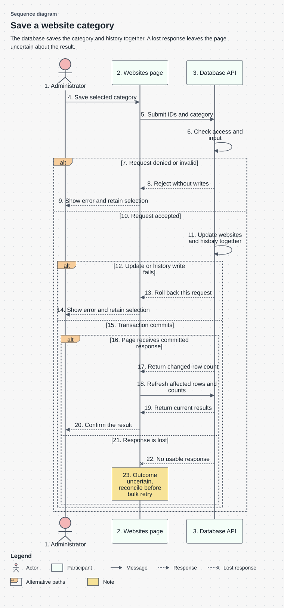

# Website review queries and category mutation design

Status: Agreed component design
Sources: [High Level Document (HLD)](high_level_document.md), [Spec Driven Development document (SDD)](spec_driven_development.md)

## Scope and requirements

This design covers classification, filtered administration reads, category writes, and browser coordination. WEB-01–WEB-05 govern reads and permissions; WEB-06–WEB-10 govern editing; WEB-11–WEB-12 constrain compatibility and performance.

A queue value is `pending`, `review`, or null for no queue restriction in a read request. The classifier itself returns null for websites in neither queue. Those two uses of null must remain distinct in callers.

## Classification and read contracts

`public.website_review_state(websites)` returns:

| Condition | Result |
| --- | --- |
| Unverified and parked by the common confirmation helper | `review` |
| Pending, or unverified and not parked | `pending` |
| Verified or any other status | null |

Evaluate the shared parked rule rather than copying its attempt/reason branches. Do not filter deletion or citation presence inside this helper; callers use it outside active administration lists too.

`_admin_websites_predicate` combines active-row filtering, queue, domain search, category, and normalized domain ending. `list_admin_websites_page`, `count_admin_websites`, and `admin_website_ids` use that predicate. Add optional `p_queue` and `p_tld` parameters with null defaults. Reject unsupported non-null queue values with SQLSTATE `22023`. Keep existing supported calls working during the compatibility release.

Pending and Review use left joins for citation information. All retains its existing citation-based population. Pending and Review default to Added descending; All keeps its existing default. Sorting uses a deterministic ID tie-breaker with the selected key. A cursor belongs to its tab/filter/sort combination and must be discarded when any of those changes.

Trim whitespace and surrounding dots and lowercase the domain ending before building a suffix condition. Empty input applies no ending restriction. Reject unsupported wildcard syntax with SQLSTATE `22023`. Use escaped literals in dynamic SQL; a validated suffix is still not an SQL identifier. The reversed-domain index supports the corresponding suffix lookup.

## Mutation contract

`bulk_change_website_category(uuid[], text)` returns the count of changed rows. The second argument is an active category ID or the clear sentinel `__clear__`.

| Input or condition | Required handling |
| --- | --- |
| Missing authenticated administrator | Deny with `42501` before writes |
| More than 500 supplied IDs | Reject with `22023` before writes |
| Empty array from an authorized caller | Return 0 |
| Unknown or deleted category | Reject with `22023` |
| Deleted website among supplied IDs | Skip it; leave its fields unchanged |
| Failure during update or journaling | Roll back the complete request |

Validate the supplied array length before reducing duplicate IDs, so duplicates cannot bypass the request limit. Treat repeated IDs as one target row when counting changes.

For an assignment, set category, verified status, high confidence, attempts 0, `verified_by = user:<authenticated UUID>`, the manual reason, and verification time together. The journal must identify the same actor through the existing authenticated change path.

For `__clear__`, set category to null, status to pending, attempts to 0, and clear verification metadata. Clearing is available through the bulk dialog, not through an empty inline selection.

The mutation and its journal entries commit together. A success response follows commit. A category or permission rejection does not partially update a request. Concurrent transactions follow last-committed-choice behavior; inspect both committed journal records in T12. This design does not add optimistic locking or promise to reject a stale editor.

### Category save results

This technical view supports transaction and failure-path review. Use the [High Level Document (HLD)](high_level_document.md) for the main workflow. Here the individual messages distinguish a rejected request, a rolled-back transaction and a committed save whose response is lost.



Read this sequence from top to bottom. It separates rejection, transaction failure, confirmed success and a lost response, because those outcomes support different claims about saved data.

| Component | Explanation |
| --- | --- |
| 1. Administrator | The administrator chooses a category and starts the save. No additional confirmation modal is implied by this diagram. |
| 2. Websites page | The page submits the selected IDs and category, shows progress, and interprets the returned result. |
| 3. Database API | The API owns authorization, input checks and the transaction that writes both website state and history. |
| 4. Save selected category | Click Save or press Enter after choosing a category. This starts the request; it is no longer the pre-submission cancellation path. |
| 5. Submit IDs and category | Send the selected website IDs and chosen category. A bulk operation splits the IDs into requests of at most 500. |
| 6. Check access and input | Verify that the current user is an administrator and that IDs and category values are valid before writing. |
| [7. Request denied or invalid] | Follow this branch if access or input checks fail. The API rejects the request before any website or history writes. |
| 8. Reject without writes | Return the rejection to the page. The database has not changed any selected website for this request. |
| 9. Show error and retain selection | Explain why saving failed and keep the selected value available for the administrator’s next action. |
| [10. Request accepted] | Follow this branch only after access and input checks pass. Acceptance here permits the transaction to begin; it is not yet a committed save. |
| 11. Update websites and history together | Apply the category changes and their history entries within the same transaction. |
| [12. Update or history write fails] | A failure in either write prevents a partial commit for this request. |
| 13. Roll back this request | Roll back the website and history writes for the failed request and return an error. Earlier successful bulk batches are separate requests and remain committed. |
| 14. Show error and retain selection | Tell the administrator that this request failed and keep the selection. Do not silently resubmit it. |
| [15. Transaction commits] | Both website changes and history have committed. Whether the page can confirm this depends on the response path below. |
| [16. Page receives committed response] | The page receives usable confirmation of the committed result and can refresh the affected data. |
| 17. Return changed-row count | Return the number of rows changed by the request. A count is confirmation of this request’s result, not evidence about unattempted bulk batches. |
| 18. Refresh affected rows and counts | Reload the affected rows and counts so that tab membership and totals reflect the saved category. |
| 19. Return current results | Return the updated list and count information using the shared filtering and classification rules. |
| 20. Confirm the result | Show the completed save to the administrator after confirmation and refresh. |
| [21. Response is lost] | The database committed, but the page did not receive usable confirmation. This branch illustrates an uncertain client outcome. |
| 22. No usable response | The crossed response arrow represents a lost response in this example. It does not mean that the database rolled back. |
| 23. Outcome uncertain, reconcile before bulk retry | Explain the uncertainty and read current values and relevant history before offering a bulk retry. Do not retry automatically. |

**Mermaid source**

```text
%% Diagram: Sequence diagram
%% View: detail
%% Subtitle: Category and history commits, including failures and lost responses.
sequenceDiagram
    accTitle: Category save results
    accDescr: The API checks administrator access and input before writing. Valid changes and history commit together. The page refreshes only after confirmation and reports uncertainty when the committed response is lost.
    actor A as 1. Administrator
    participant UI as 2. Websites page
    participant DB as 3. Database API
    A->>UI: 4. Save selected category
    UI->>DB: 5. Submit IDs and category
    DB->>DB: 6. Check access and input
    alt 7. Request denied or invalid
        DB-->>UI: 8. Reject without writes
        UI-->>A: 9. Show error and retain selection
    else 10. Request accepted
        DB->>DB: 11. Update websites and history together
        alt 12. Update or history write fails
            DB-->>UI: 13. Roll back this request
            UI-->>A: 14. Show error and retain selection
        else 15. Transaction commits
            alt 16. Page receives committed response
                DB-->>UI: 17. Return changed-row count
                UI->>DB: 18. Refresh affected rows and counts
                DB-->>UI: 19. Return current results
                UI-->>A: 20. Confirm the result
            else 21. Response is lost
                DB--xUI: 22. No usable response
                Note over UI: 23. Outcome uncertain, reconcile before bulk retry
            end
        end
    end
%% Legend: lost | Lost response
```

Numbers identify message order within this scenario. The alternative blocks distinguish rejection, transaction failure, confirmed commit and response loss; the crossed response arrow represents a lost message.

## Browser state and failure handling

The shared edit hook tracks active row, selected category, saving state, and error. Opening a second row closes an unsaved first edit after canceling its local selection. While a save is pending, reject another save for that row. Enter invokes save; Escape cancels only while no save is in flight. A failed save retains the row and selection for retry.

### Inline editor states



The states describe the editor’s lifecycle. Numbered transitions identify the user action or result that moves it between states; the note explains what is blocked while saving.

| Component | Explanation |
| --- | --- |
| 1. Start | The initial-state symbol marks entry into this editor lifecycle. Its visible reference sits beside the solid circle to preserve state-machine notation. |
| 2. Idle | No row is currently being edited. The administrator can open a row’s category editor. |
| 3. Editing | One row has a local category selection that can be changed, saved, or canceled before submission. |
| 4. Saving | The request is in flight. The editor prevents another save for this row and waits for the result. |
| 5. Open row | Opening the row moves the editor from Idle to Editing. |
| 6. Change selection | Choosing another category keeps the editor in Editing; the database has not received a save yet. |
| 7. Cancel before saving | Click Cancel or press Escape before submission to discard the local selection and return to Idle. |
| 8. Save | Click Save or press Enter to submit the category and enter Saving. |
| 9. Save fails | A failed save returns to Editing with the selected category retained, so the administrator can decide the next action. |
| 10. Save succeeds | A confirmed save closes the editor, refreshes affected data and returns to Idle. |
| 11. Block duplicate saves; Escape cannot cancel an in-flight request | While saving, reject duplicate submission. Escape does not undo a request already sent to the database. |

**Mermaid source**

```text
%% Diagram: State diagram
%% View: detail
%% Subtitle: Editing, saving and failure states for one website category.
%% Reference: root_start | 1. Start
stateDiagram-v2
    direction LR
    accTitle: Category editor states
    accDescr: Opening a row starts editing. Save enters an in-flight state, where duplicate saves and cancellation are blocked. Failure returns to editing with the selection; confirmed success closes the editor and refreshes data.
    state "2. Idle" as Idle
    state "3. Editing" as Editing
    state "4. Saving" as Saving
    [*] --> Idle
    Idle --> Editing: 5. Open row
    Editing --> Editing: 6. Change selection
    Editing --> Idle: 7. Cancel before saving
    Editing --> Saving: 8. Save
    Saving --> Editing: 9. Save fails
    Saving --> Idle: 10. Save succeeds
    note right of Saving
        11. Block duplicate saves; Escape cannot cancel an in-flight request
    end note
```

Transition labels identify the triggering action or outcome. The attached note describes restrictions while saving.

### Bulk coordination and recovery

The bulk coordinator snapshots the selected IDs, partitions them into at most 500 IDs per request, and submits sequentially. It tracks:

- Confirmed batches and their returned changed-row counts.
- The batch that failed or lost its response.
- IDs not yet attempted.

A definite server rejection rolls back that request. A transport failure may occur after commit, so label that batch unresolved. Stop further submissions in either case. Refresh confirmed progress immediately, then re-read the unresolved IDs through the authorized read path. Show current values and history context before offering an explicit retry. A retry is a new attributable decision and can overwrite a concurrent edit; never perform it silently.

The [Visual Guidance (VG)](visuals.md) illustrates this failure branch for WEB-09 and T16 without duplicating it here.

On full or partial completion, invalidate the affected list and count queries. Preserve the administrator's tab and filters, but reset a cursor that no longer identifies a valid page. Avoid a stale success message that announces the original selection size when fewer active rows changed.

## Compatibility and migration

M1 introduces classification and dependent readers. M2 adds optional administration filters. M3/M4 build indexes concurrently in separate migration units. M5 adds the attributed mutation. Generated TypeScript contracts must match those database signatures before the new UI is enabled.

Keep old read calls supported until the next compatibility release. M6 later removes the obsolete Review filter parameters after caller inspection. An interface rollback leaves additive database support and history intact.

### Data definition and invariants

For this example, the design preserves the UUID identity, opaque category ID, nullable category and verification fields described above. Assignment and clear have different invariants; a null queue filter is not the classifier's null result. Mutation and journal share a transaction. The supplied design does not specify every column type/default, storage constraint or retention rule, so a complete data dictionary and actual database isolation settings require source confirmation. Do not invent them from the interface. Verify allowed state transitions and actor identity through the linked cases.

## Decisions and verification

The [Decision Record (DR): architecture](decision_record_architecture.md) selects one database classification rule. The [Decision Record (DR): component design](decision_record_component_design.md) selects explicit reconciliation rather than automatic bulk retry.

T01–T08 cover reads and authorization. T09–T17 cover editor state, atomic writes, metadata, concurrency, bulk boundaries, response loss, and refreshed state. T18–T20 cover controls, compatibility, and measured database behavior. These checks are defined in the [Test Specification (TS)](test_specification.md).

Before implementation, confirm the exact parked-helper signature, journal trigger behavior, and migration tool's concurrent-index support. A mismatch requires design reconciliation; changing the behavior silently is not an acceptable implementation shortcut.
