# Websites Review behavior specification

Status: Approved behavior baseline, version 1 2026-10-27
Source: [Product Requirements Document (PRD)](product_requirements_document.md)

## Purpose and scope

Administrators can distinguish websites still awaiting automation from websites requiring human review, then assign or clear categories reliably. This specification covers the three administration tabs, their filters and selection, category editing, and associated permissions and history.

It excludes changes to categorization rules, restarting parked work, backfills, and a new Review-reason filter. It preserves the existing All population. The [Implementation Plan (IP)](implementation_plan.md) owns delivery order and the [Low Level Design (LLD)](low_level_design.md) owns SQL and component contracts.

## Definitions

- **Active website:** A website not marked deleted.
- **Parked:** The shared confirmation rule, `website_confirm_is_parked`, says automated confirmation has stopped for the website.
- **Pending:** A pending-status website, or an unverified website that is not parked.
- **Review:** An unverified website that is parked.
- **All:** The existing administration population, which requires a citation aggregate. It is not the union of Pending and Review.
- **Confirmed batch:** A request whose successful response confirms the changed-row count.
- **Unresolved batch:** A request that failed or whose outcome cannot yet be established. A missing response is not proof that its writes rolled back.

## Scenarios

An administrator finds a parked, uncited website in Review, reads its reason, and assigns a category. The saved website becomes verified and leaves Review. Clearing a category through the bulk dialog instead returns the website to Pending.

A failed inline save keeps the selected value available. A bulk operation may finish some requests before a later request fails. Its feedback distinguishes confirmed changes from unresolved work, and the displayed queue data reflects confirmed progress.

### Review and edit a website

This user flow connects access and inline editing outcomes from WEB-05, WEB-06 and WEB-10. It describes visible behavior; database interaction belongs in High Level Document (HLD)/Low Level Design (LLD).



The flow follows an administrator from opening the page to saving or canceling a category edit. Yes and No label outcomes of system checks; they do not add a confirmation modal.

| Component | Explanation |
| --- | --- |
| 1. Open Websites | Open the Websites page to browse review tabs and change a website’s category. |
| 2. Is the signed-in user an administrator? | The system checks the current user’s role. Yes follows the administrator path; No denies access. This is an access check, so the user does not answer a confirmation dialog. |
| 3. Access denied; no category change | If the user lacks administrator access, the system denies the category operation and leaves the data unchanged. |
| 4. Choose tab and filters | Choose a review tab and any filters to find the websites that need attention. Rows and counts use the same filtering rules. |
| 5. Open one row's category editor | Open the category picker for a row. Only one row’s editor is active at a time, so another unsaved edit cannot remain open alongside it. |
| 6. Choose category | Choose the category to assign. The selection stays local until Save is requested; selecting a value alone does not update the database. |
| 7. Save or cancel? | Click Save or press Enter to submit the selection. Click Cancel or press Escape before submission to discard it. |
| 8. Discard unsaved selection | Cancel closes the editor without sending a category update. This path applies before saving starts; it cannot cancel a request already in flight. |
| 9. Show saving; prevent duplicate submission | While the request is in flight, show that saving is underway and prevent another save for that row. |
| 10. Did the page receive confirmation? | The page checks whether it received a successful committed response. A definite error and a missing response both need feedback, but a missing response does not prove that the database rolled back. |
| 11. Refresh rows and counts; show result | After confirmed success, close the edit, refresh the affected rows and counts, and show the result. The website may move to another tab under the shared review rules. |
| 12. Show error; retain selected category | Keep the chosen category available and explain the failure or uncertainty. The administrator decides the next action. For an unresolved bulk result, reconcile saved state before offering an explicit retry. |

**Mermaid source**

```text
%% Diagram: User flow
%% View: detail
%% Subtitle: Saving, cancelling and retrying an administrator’s category change.
flowchart TD
    accTitle: Website category editing
    accDescr: Authorized administrators browse a tab, edit a category, and save or cancel. Saving prevents duplicate submission. A confirmed save refreshes rows and counts; failure retains the selection for an explicit further action.
    A(["1. Open Websites"]) --> B{"2. Is the signed-in user an administrator?"}
    B -->|No| C(["3. Access denied; no category change"])
    B -->|Yes| D["4. Choose tab and filters"]
    D --> E["5. Open one row's category editor"]
    E --> F["6. Choose category"]
    F --> G{"7. Save or cancel?"}
    G -->|Cancel or Escape before saving| H(["8. Discard unsaved selection"])
    G -->|Save or Enter| I["9. Show saving; prevent duplicate submission"]
    I --> J{"10. Did the page receive confirmation?"}
    J -->|Yes| K(["11. Refresh rows and counts; show result"])
    J -->|Failure or no confirmation| L["12. Show error; retain selected category"]
    L -->|Administrator chooses next action| F

class A,C,H,K terminator
class B,G,J decision
class D,E,F,I,L process
```

Category clearing uses the bulk dialog under WEB-08. All, Pending and Review are browsing populations, not successive lifecycle states.

## Requirements and business rules

### WEB-01: Classify outstanding work consistently

An unverified parked website must classify as Review. A pending website or unverified non-parked website must classify as Pending. Verified websites and other statuses must classify as neither. Classification must use the common parked rule; citation availability and deletion are separate visibility conditions.

### WEB-02: Show the intended population

Pending and Review must include every active qualifying website under the selected filters, including websites without citation aggregates. Deleted websites must be excluded. All must retain its existing active, cited population. A website can be absent from All while present in Pending or Review.

### WEB-03: Apply filters predictably

Domain search, category, and domain-ending filters must work together on every tab. Normalize ending input by trimming whitespace and surrounding dots and converting to lowercase. `.CN`, ` cn `, and `cn.` must behave like `cn`; `co.uk` must be supported. Reject wildcard inputs such as `c%n` and `*.cn` without running a broader match. An empty ending applies no ending restriction.

### WEB-04: Keep browsing and selection consistent

Rows, counts, and matching-ID selection must apply the same filters and active population. Pending and Review must open in Added descending order; All keeps its existing default. Pagination must not repeat or skip rows on an unchanged dataset. A tab or filter change must reset the previous page cursor.

### WEB-05: Enforce administrator access

Only signed-in administrators may read these administration lists or change categories. Direct calls must enforce access even if a client bypasses the interface. Denied requests must not change website data or create a successful-change history entry.

### WEB-06: Support dependable inline assignment

Every tab must support assigning a category inline, with one row in edit mode at a time. Enter or the save action submits; Escape or cancel discards an unsaved selection. While saving, show progress and prevent duplicate submission. On failure, show an error and retain the selected category in edit mode. Clearing a category is available through the bulk dialog only.

### WEB-07: Confirm and attribute manual assignments

Status/source: Agreed in behavior baseline version 1.

Statement: A successful category assignment must persist an active category, mark the website verified at high confidence, reset category attempts, record the manual reason and verification time, and identify the acting administrator. A fresh read must return the saved result. Change history must retain the actor and changed values. The last committed concurrent manual choice wins; both committed choices remain attributable.

Verification: T11–T12 check fresh persistence, verification metadata, actor history and concurrent saves.

### WEB-08: Reset cleared categories to Pending

A successful bulk clear must remove the category, set verification status to Pending, reset attempts, and clear prior verification metadata. It must not present the website as manually verified. Deleted websites must remain unchanged for both assignment and clearing.

### WEB-09: Respect request boundaries and partial completion

A request may contain at most 500 website IDs. An empty request returns zero changed rows; a larger request is rejected before changing rows. An invalid or deleted target category is rejected. Each accepted request is atomic.

For a larger selection, submit sequential batches. After the first failed request, stop submitting further batches. Keep confirmed progress, the unresolved batch, and unattempted IDs distinguishable. Do not retry an uncertain write automatically. Reconcile its actual state before presenting a retry, and make any retry an explicit administrator action.

### WEB-10: Refresh and report the actual result

After confirmed changes, refresh affected rows and tab counts. A Review row assigned a category must disappear from that queue; a cleared Review row must become Pending. Refresh confirmed progress after a partial bulk operation as well. Never label a partial or uncertain operation fully successful.

### WEB-11: Preserve controls and compatibility

Place the domain-ending field in More filters. Keep school filtering, Populate from Citations, and Add New on All only. Show the reason on Review, hide its ineffective Check category action, and remove the superseded Review status filter. Existing read callers that omit the new optional filters must retain their behavior during the compatibility release.

## Quality and interface constraints

Permissions, filtering, request limits, and compatibility follow WEB-03–WEB-11. The database limits below define measurable acceptance separately from browser response time.

### WEB-12: Meet the measured database limits

For the agreed production-shaped snapshot, each default Pending and Review first-page database query must complete within 1,000 ms and access no more than 5,000 PostgreSQL shared-buffer pages, counting hits plus reads. Record query text, dataset, sort, and measurement conditions. These are database execution limits, not browser-response limits.

A 500-ID category mutation with journaling enabled must finish below the authenticated role's eight-second statement timeout. Validate index build duration and size before production scheduling; no build-time limit is assumed.

## Acceptance criteria

| Requirement | Check and expected result |
| --- | --- |
| WEB-01 | T01–T02 classify all nine fixtures and preserve automated reader results |
| WEB-02 | T03 finds 3 active Review rows, 4 Pending rows, and the 6 existing All rows |
| WEB-03 | T04–T05 normalize endings, reject wildcards, and combine filters |
| WEB-04 | T06–T07 compare list/count/IDs and traverse unchanged data without repetition |
| WEB-05 | T08 denies non-administrator and unauthenticated direct requests |
| WEB-06 | T09–T10 cover save, cancel, progress, duplicate prevention, and retained failure state |
| WEB-07 | T11–T12 inspect persistence, verification metadata, actor history, and concurrent saves |
| WEB-08 | T13 verifies clear transitions and deleted-row protection |
| WEB-09 | T14–T16 cover limits, atomic failure, definite rejection, and uncertain responses |
| WEB-10 | T17 verifies refreshed rows and counts after full and partial changes |
| WEB-11 | T18–T19 inspect controls, layout, and old caller compatibility |
| WEB-12 | T20 records production-shaped query, mutation, and index measurements |

## Open decisions and changes

No behavior decision blocks this baseline. Operational adoption targets remain a product follow-up and are not release acceptance thresholds. Index build scheduling depends on measurement.

A change to queue membership, permissions, clearing, or bulk failure handling requires an explicit revision of this specification and its checks. Do not redefine the behavior in an implementation step or report.

## Related design and work

The [High Level Document (HLD)](high_level_document.md) describes system boundaries. The [Low Level Design (LLD)](low_level_design.md) defines internal contracts. The [Implementation Plan (IP)](implementation_plan.md) sequences delivery; the [Test Specification (TS)](test_specification.md) supplies procedures.
