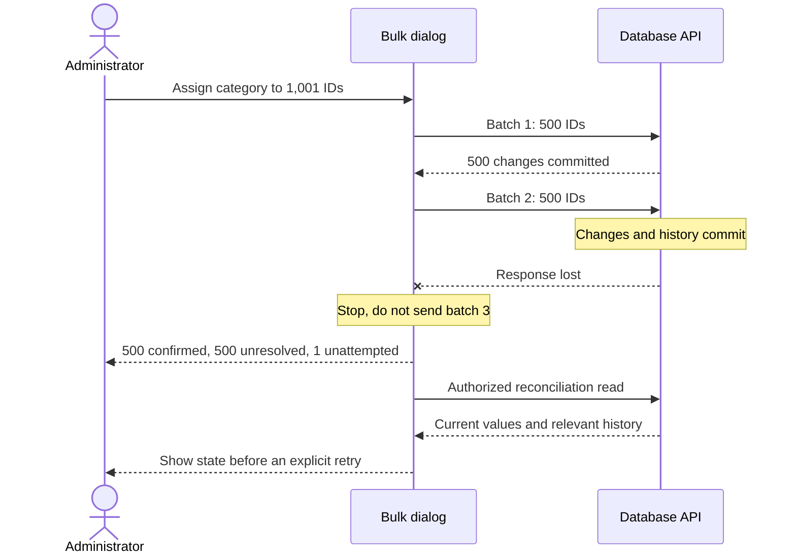

# How a partial bulk change stops and recovers

This sequence shows the Websites Review design for a 1,001-ID selection when the second request loses its response after committing.

The first successful response confirms 500 changed rows. Losing the second response does not establish rollback, so those 500 IDs remain unresolved until reconciliation. The last ID is unattempted. The client must not report that only 500 rows changed in the database; it can only confirm that many before the read.

Each mutation request is atomic, but the entire selection is not one transaction. The [DDR](design_decision_record.md) explains the retry tradeoff, and T16 in the [test specification](test_specification.md) checks this branch.
