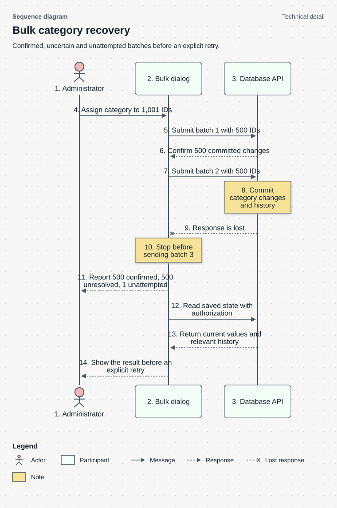

# How a partial bulk change stops and recovers

This is a technical-detail example. For a general workflow, start with the [Website review workflow](../references/visuals.md#start-with-an-overview) and add only the detail the reader needs.

This sequence shows the Websites Review design for a 1,001-ID selection when the second request loses its response after committing.



This scenario explains why a missing response must be reconciled before a bulk retry. It keeps server events separate from what the dialog can confirm.

| Component | Explanation |
| --- | --- |
| 1. Administrator | The administrator requests one category for all 1,001 selected websites. |
| 2. Bulk dialog | The dialog sends batches in order and tracks confirmed, unresolved and unattempted IDs separately. |
| 3. Database API | Each request authorizes the caller and commits category changes with their history entries. |
| 4. Assign category to 1,001 IDs | Start the bulk operation from the selected IDs. The 500-ID request limit requires three batches. |
| 5. Submit batch 1 with 500 IDs | Send the first 500 IDs and wait for its result before continuing. |
| 6. Confirm 500 committed changes | The first response confirms 500 changes, so the dialog records those IDs as completed. |
| 7. Submit batch 2 with 500 IDs | Send the next 500 IDs. The final remaining ID has not yet been submitted. |
| 8. Commit category changes and history | The second transaction commits its changes and history. This is known in the illustrated server scenario, but the client has not received confirmation. |
| 9. Response is lost | The response does not reach the dialog. The client cannot infer rollback or success from the missing response alone. |
| 10. Stop before sending batch 3 | Stop after the unresolved result. Keep the last ID unattempted and avoid automatically resending the second batch. |
| 11. Report 500 confirmed, 500 unresolved, 1 unattempted | Tell the administrator what the client can establish: 500 confirmed IDs, 500 with an unknown result, and one never attempted. These groups total 1,001. |
| 12. Read saved state with authorization | Use an authorized read to reconcile current category values and relevant history for the unresolved IDs. |
| 13. Return current values and relevant history | Return the available evidence. A current value alone may not establish which request wrote it; preserve any remaining uncertainty. |
| 14. Show the result before an explicit retry | Show the reconciled state and let the administrator decide whether to retry the appropriate IDs. No automatic retry is implied. |

**Mermaid source**

```text
%% Diagram: Sequence diagram
%% View: detail
%% Subtitle: Confirmed, uncertain and unattempted batches before an explicit retry.
sequenceDiagram
    accTitle: Bulk category recovery
    accDescr: Of 1,001 selected websites, the first 500 changes are confirmed, the second 500 are unresolved from the client perspective, and one remains unattempted. Read current state and history before an explicit retry.
    actor A as 1. Administrator
    participant UI as 2. Bulk dialog
    participant DB as 3. Database API
    A->>UI: 4. Assign category to 1,001 IDs
    UI->>DB: 5. Submit batch 1 with 500 IDs
    DB-->>UI: 6. Confirm 500 committed changes
    UI->>DB: 7. Submit batch 2 with 500 IDs
    Note over DB: 8. Commit category changes and history
    DB--xUI: 9. Response is lost
    Note over UI: 10. Stop before sending batch 3
    UI-->>A: 11. Report 500 confirmed, 500 unresolved, 1 unattempted
    UI->>DB: 12. Read saved state with authorization
    DB-->>UI: 13. Return current values and relevant history
    UI-->>A: 14. Show the result before an explicit retry
%% Legend: lost | Lost response
```

Message numbers identify local interaction order. A crossed arrow represents the lost response; notes explain the commit and stop conditions. Batch numbers identify separate mutation requests, not participant hierarchy.

Each mutation request is atomic, but the entire selection is not one transaction. The [Decision Record (DR): component design](decision_record_component_design.md) explains the retry tradeoff, and T16 in the [Test Specification (TS)](test_specification.md) checks this branch.
