# Visual Guidance (VG)

Use this shared component for visuals inside any document or as standalone outputs. The owning reference defines the content; this guide handles visual selection, construction and checks. It does not authorize product or design choices.

## Decide whether a visual is needed

Inspect sources and identify the reader's question. Use visuals for relationships, branches, order, lifecycle, layout, deployment or data that prose cannot clearly explain. Otherwise use text or a table. Reuse maintained views; select only needed types.

Follow [discovery](../workflows/discover.md) for missing choices. Do not invent infrastructure, states, retries, approval, measurements or screen behavior.

## Keep the view understandable

Start with an overview for a reader who does not know the project. Show one question at one level: the main path, not every validation, transaction, rollback and recovery branch together. Collapse internal work into a named subprocess. Explain exceptions in prose or separate technical views only when useful. Do not add more diagrams merely to fill a template.

Use `%% View: overview` (the default), `detail` for a deliberately selected technical view, or `reference` for a catalog such as the symbol guide. The exporter shows this level and enforces the house readability budgets in `scripts/title_contract.py`; these are local guardrails, not industry-standard node limits. A reference view is not a way to bypass an oversized workflow. State why technical detail is needed in the owning document's visual-selection record.

Use a short topic title and one brief scope subtitle. Accessibility descriptions may explain more; keep them in plain language. Keep step labels as actions. Check whether the reader can explain the main path without reading the whole table. A readable layout and passing syntax check do not prove understanding.

A self-message assigns responsibility to that participant. If the source requires an action but leaves its owner unknown, use an explicitly numbered note spanning the relevant participants and state that uncertainty in the explanation. Do not invent an owner or endpoint to finish the diagram.

## Choose the view

Use [visual selection](../workflows/visual_selection.md) to match the reader’s question to an established view and its owning document. It covers architecture levels, deployment, interactions, user flows, states, entities, data boundaries and evidence. Select only the views needed; inspect available facts before asking for unresolved choices.

## Start with an overview



This view covers a successful category save. Failed or uncertain saves need different handling; keep that explanation in the document or a separately scoped view. Do not infer who reconciles saved state when the source leaves that responsibility unknown.

| Component | Explanation |
| --- | --- |
| 1. Submit category change | The administrator submits the selected website IDs and the chosen category. This does not prescribe particular controls or clicks. |
| 2. Validate and save changes | The API validates access and input, then saves the category change and its history. The subprocess keeps those internal steps out of the overview. |
| 3. Refresh rows and counts | After the page receives confirmation of the save, it refreshes both the website rows and their counts. |
| 4. Show confirmation | The page confirms the result to the administrator. A lost response does not follow this confirmed-success path. |

**Mermaid source**

```text
%% Diagram: Flowchart
%% View: overview
%% Subtitle: Successful category changes, from submission to confirmation.
flowchart LR
    accTitle: Website review workflow
    accDescr: An administrator submits selected websites and a category. The API validates and saves the change. After confirmation, the page refreshes rows and counts and shows the result.
    SEND["1. Submit category change"] --> API@{ shape: fr-rect, label: "2. Validate and save changes" }
    API -->|"Save confirmed"| REFRESH["3. Refresh rows and counts"]
    REFRESH --> SHOW@{ shape: curv-trap, label: "4. Show confirmation" }
class SEND,REFRESH process
class API predefined
class SHOW display
```

## Flowchart symbol guide



Use this guide to choose symbols for a flowchart. The pink person box is a local convention for this view, not an ISO flowchart symbol. The shapes carry meaning, while these fills are the shared house palette. Sequence and state diagrams keep their own notation. Numbers identify the symbols; they do not prescribe an execution order.

| Component | Explanation |
| --- | --- |
| 1. Process | Use for an action such as validating a submitted category. Shared fill: #F4FEF8. |
| 2. Decision | Use for a condition that selects a branch. Label outgoing paths, for example Yes and No. Shared fill: #F7E398. |
| 3. Document | Use for a document consumed or produced by the process. Shared fill: #D2D2D2. |
| 4. Data (input/output) | Use for data entering or leaving the process, such as an entered category value. Shared fill: #C4B1FB. |
| 5. Start / end | Use for the beginning or end of a flowchart path. Shared fill: #C4B1FB. |
| 6. Predefined process | Use for a named subprocess whose steps are defined elsewhere. Shared fill: #B3F1C6. |
| 7. Connector | Use to continue a path without a long crossing line. Yes and No belong on decision branches. Shared fill: #FFFFFF. |
| 8. Preparation | Use for initialization or setup before the next action. Shared fill: #FFF9FF. |
| 9. Display | Use for information shown on a screen. Shared fill: #F7E398. |
| 10. Paper tape | Use only when continuous paper output is relevant; ordinary files use Document or Data. Shared fill: #F7CAFB. |
| 11. Delay | Use for an intentional wait, not an unknown or failed result. Shared fill: #B6F6FF. |
| 12. Manual operation | Use for a step performed manually rather than by the software. Shared fill: #F4FEF8. |
| 13. Person | Use for a person in this flowchart palette. The pink rounded rectangle is a local convention; sequence diagrams retain their standard actor notation. Shared fill: #F4B6B7. |
| 14. Database | Use for a database or persistent store. Shared fill: #C4B1FB. |
| 15. Expanded subprocess | Use a labeled group when the subprocess steps are shown inside the same view. Shared fill: #F7CD9B. |
| 15.1. Validate selection | This process is shown inside the expanded subprocess. Check the selected category before saving; its number reflects the actual parent group. |
| 15.2. Save category | This process is the next step inside the same subprocess. Use the permitted save operation after validation. |

**Mermaid source**

```text
%% Diagram: Flowchart
%% View: reference
%% Subtitle: Supported symbols, their meanings and the shared color palette.
flowchart LR
    accTitle: Flowchart symbols
    accDescr: A numbered guide to supported flowchart symbols. Each shape has one meaning and a shared color. The expanded subprocess contains its own steps.
    N1@{ shape: rect, label: "1. Process" }
class N1 process
    N2@{ shape: diam, label: "2. Decision" }
class N2 decision
    N3@{ shape: doc, label: "3. Document" }
class N3 document
    N4@{ shape: lean-r, label: "4. Data (input/output)" }
class N4 data
    N5@{ shape: stadium, label: "5. Start / end" }
class N5 terminator
    N6@{ shape: fr-rect, label: "6. Predefined process" }
class N6 predefined
    N7@{ shape: circle, label: "7. Connector" }
class N7 connector
    N8@{ shape: hex, label: "8. Preparation" }
class N8 preparation
    N9@{ shape: curv-trap, label: "9. Display" }
class N9 display
    N10@{ shape: flag, label: "10. Paper tape" }
class N10 paper
    N11@{ shape: delay, label: "11. Delay" }
class N11 delay
    N12@{ shape: trap-t, label: "12. Manual operation" }
class N12 manual
    N13("13. Person")
class N13 actor
    N14@{ shape: cyl, label: "14. Database" }
class N14 datastore
    subgraph N15["15. Expanded subprocess"]
        N15a["15.1. Validate selection"] --> N15b["15.2. Save category"]
    end
class N15 subprocess
class N15a,N15b process
N1 ~~~ N2 ~~~ N3 ~~~ N4
N5 ~~~ N6 ~~~ N7 ~~~ N8
N9 ~~~ N10 ~~~ N11 ~~~ N12
N13 ~~~ N14 ~~~ N15
```

## Construct and explain

Follow [visual selection](../workflows/visual_selection.md) for notation and source checks, and [diagram rendering](../workflows/diagram_rendering.md) for export and delivery. Every meaningful component needs a unique visible number and label. Below the image, provide an overview and one table row per component with the identical complete number and label. Explain relevant conditions, actions, feedback and next paths in natural language; embed the exact source directly below the table.

## Integrate and check

Keep visuals beside their explanation. Plans and tests link maintained views. Spec Driven Development document (SDD) owns behavior; decision records own choices. Update views from verified implementation, not assumed deployment.

For a view selected for checked delivery, add an entry to `context.visuals`:

```json
{"heading":"Category changes","notation":"diagram_svg","reason":"Explain commit confirmation and failure outcomes."}
```

Use an empty list when no visual is needed. Use `diagram_svg` for exports or `flowchart_svg` for the flowchart convention. Other notation IDs support source/draft checks; review external artifacts separately.

The gate checks selected views, visible context, on-canvas symbol/label pairs, source binding and surrounding explanations. Check syntax/rendering separately from meaning and actual symbol coverage. Unavailable checks remain not run; unvalidated outputs stay drafts.

## Completed example

The [complete bulk-recovery example](../examples/visuals.md), [Spec Driven Development document (SDD) user flow](../examples/spec_driven_development.md), [High Level Document (HLD) views](../examples/high_level_document.md) and [Low Level Design (LLD) editor states](../examples/low_level_design.md) demonstrate complementary views of Websites Review.

## Quality check

Check source support, reader understanding, paths, transitions, data/boundaries, consistency across views and acceptance criteria. Syntax, rendering and meaning need separate assessment.

## Sources

- [C4 diagrams](https://c4model.com/diagrams), [review checklist](https://c4model.com/diagrams/checklist)
- [arc42 runtime scenarios](https://docs.arc42.org/section-6/)
- [NN/g: journeys and flows](https://www.nngroup.com/articles/user-journeys-vs-user-flows/), [wireflows](https://www.nngroup.com/articles/wireflows/)
- [IBM: UML diagrams](https://www.ibm.com/docs/en/dma?topic=diagrams-activity), [ERDs](https://www.ibm.com/think/topics/entity-relationship-diagram)
- [OMG: BPMN](https://www.omg.org/bpmn/), [OWASP: threat modeling](https://cheatsheetseries.owasp.org/cheatsheets/Threat_Modeling_Cheat_Sheet.html)
- [Mermaid accessibility](https://mermaid.js.org/config/accessibility.html)
