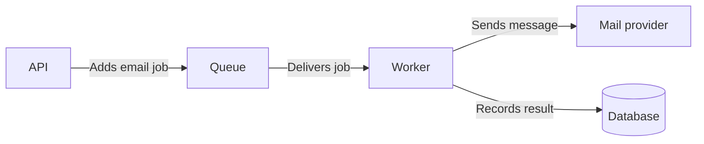

# Visual Guidance (VG)

Use a visual when it makes relationships, sequences, structure, or observed appearance easier to understand than prose alone. Every visual must answer a reader question and agree with the accompanying text. Create a visual when a reader needs those relationships or evidence; update it when the represented facts change. Do not require a diagram for every document.

## Choose the format

| Need | Suitable form |
| --- | --- |
| System and external services | C4 system context diagram |
| Applications, workers, data stores | C4 container diagram |
| Responsibilities inside an application | Component diagram |
| Events and requests in order | Sequence diagram or numbered flow |
| Decision points and branches | Flowchart |
| Exact UI layout or visual defect | Screenshot with relevant viewport and version |
| Compare values over time | Chart with units, period, and source |
| Compare a few fields or options | Table, often simpler than a diagram |

## Principles

1. Give each visual a title that tells readers what they are seeing. Make labels familiar and specific.
2. Include a legend where shapes, colors, or abbreviations would otherwise be unclear. Do not rely on color alone.
3. Label connectors with the interaction or data they represent when this matters to understanding.
4. Match detail to the reader. Start with the whole system if the reader first needs orientation; zoom in only where useful.
5. Describe in prose what the visual demonstrates. Explain important branches, boundary crossings, and failure paths.
6. Use diagrams as code when the repository can render them reliably; otherwise use the supported local diagram format. Keep sources editable.
7. Verify diagrams against actual code, deployment information, and governing requirements. Keep source-reported facts distinct from independently checked ones. Label proposals and hypothetical examples explicitly.
8. Use a screenshot when appearance matters. For API, data, or performance problems, logs, tables, or measurements may communicate the evidence better.
9. Make visuals accessible: meaningful alternative text, readable labels, and a textual description of critical information.

## Template

```md
### [Meaningful diagram title]

[One sentence identifying the scope and status: actual/proposed/example.]

[Diagram in the project's supported format.]

[Paragraph explaining the key connections and any conditions the diagram alone cannot convey.]
```

## Completed example: a queued notification

This is a proposed, simplified flow, not an existing implementation.



The API places a job on the queue after accepting a request. A worker retrieves it, sends the message through the mail provider, and records the outcome. The diagram leaves out retries and error handling because the example has no approved retry policy; a production diagram should include those paths once defined.

## Quality check

The reader can identify what each box represents, why the connections exist, and whether the diagram describes current or proposed behavior. The visual adds information and is readable without relying on color. Check rendering in the target format and provide enough text for someone who cannot see the image. A diagram of engineering stages explains relationships; it does not authorize performing those stages.

## Sources

- C4 diagrams: https://c4model.com/diagrams
- Google accessibility guidance: https://developers.google.com/style/accessibility
